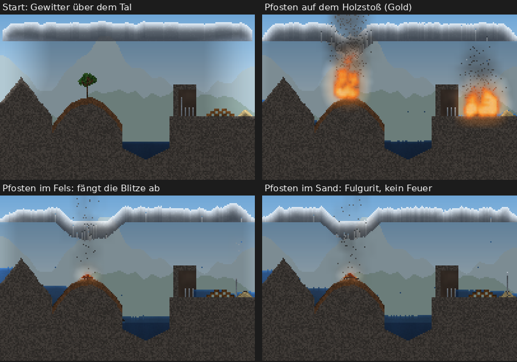
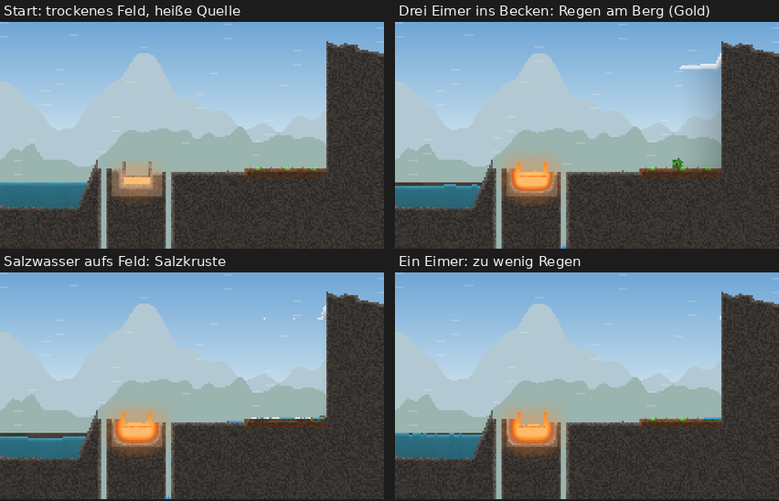

# Phase 3c: Bericht

Phase 3c nach 3b, vor Phase 4: Atmosphäre und Wetter. Wolken, Regen und Schnee, Wind, Gewitter mit Blitzen, Wetter im Level-Format und in den Vorlagen, Wetterregler im Spielplatz. Phase 4 ist nicht begonnen.

**Build:** [`beta-99`](https://github.com/shootcat/ReAct/releases/tag/beta-99), APK und Screenshots dort.

**Nachtrag mit Level 4 und 5:** [`beta-101`](https://github.com/shootcat/ReAct/releases/tag/beta-101). Der Zwischenstand mit Level 4, beta-100, war ebenfalls grün. Was sich dafür an der Physik geändert hat, steht in Abschnitt 9; die Abschnitte 1 bis 4 sind auf den neuen Stand gebracht.

**Korrektur „schräges Metall gleitet“:** [`beta-102`](https://github.com/shootcat/ReAct/releases/tag/beta-102), Abschnitt 10.
- beta-97 und beta-98 waren rot, beide nur am neuen App-Test; Simulation, Level und alle übrigen App-Tests waren grün.
  - beta-97: Der Test fand den Menüeintrag „Wetter …“ nicht.
  - beta-98: Der Test gibt jetzt bei einem Fehlschlag den Bildschirm aus. Daran war die Ursache zu sehen: Der Eintrag war versehentlich ins Menü des Level-Bildschirms geraten statt ins Menü des Spielplatzes. Dort öffnete er nichts, weil die Wetterregler im Level gesperrt sind.
  - Behoben: Der Eintrag steht jetzt im Spielplatz-Menü; das Level-Menü ist wieder wie in 3b.

## 1. Dampf, Kondensationshöhe, Wolken

- **Neues Material „Wolke“** (`cloud`): ein Gas, doppelt so dicht wie Dampf und so dicht wie Luft (es schwebt, statt zu steigen), weiß, zu 80 % lichtdurchlässig. Im Spielplatz liegt es unter „Flüssig“ neben Dampf.
- **Kondensationshöhe** (`cloud_base`): eine Zeile pro Welt.
  - Im Level steht sie in der `level.json`.
  - In den Vorlagen hängt sie von der Landschaft ab: Wiese, Feld, Insel, Küste und Vulkan auf 16 % der Höhe von oben, der Berg auf 20 %, das Höhlensystem auf 10 %.
  - Ohne Kondensationshöhe gibt es keine Wolken, und alles läuft wie vor 3c.
- **Dampf im Freien** kühlt beim Steigen ab, 0,3 °C pro Zeile. Ab der Kondensationshöhe wird er zu Wolke, nicht zu Wasser. Darunter kondensiert er nur an kalten Flächen (unter 60 °C), etwa an einem kalten Felsüberhang.
- **Dampf in geschlossenen Höhlen** kondensiert wie bisher an den kalten Wänden, auch wenn die Welt eine Kondensationshöhe hat. Geschlossen heißt: kein Weg zum Himmel. Das prüft dieselbe Raumerkennung wie für den Druck.
- **Wolken ballen sich:** Unter der Kondensationshöhe steigt Wolke auf. Darüber sinkt sie, solange Luft unter ihr ist, und rutscht schräg von anderer Wolke ab. So bilden sich Haufen an der Kondensationshöhe statt Eiszapfen. Neuer Dampf, der von unten kommt, legt sich oben auf den Haufen.
- **Auflösen:** Ein einzelner Fetzen ohne Nachbarn löst sich langsam auf. Ohne Kondensationshöhe (Wolken im Spielplatz ausgeschaltet) verschwinden alle Wolken nach und nach.
- Gemessen (`WeatherTest`): Offener Dampf (288 Zellen) wird in 15 s zu 270 Zellen Wolke, 18 Zellen sind schon als Regen gefallen. Ohne Kondensationshöhe werden daraus wie früher 288 Zellen Wasser. In einer geschlossenen Höhle mit Kondensationshöhe entsteht keine Wolke.

## 2. Regen und Schnee

- Eine Wolke regnet aus ihrer **Unterseite**, wo sie mindestens 4 Zellen dick ist: Alle 10 Schritte wird dort jede unterste Wolkenzelle mit 1 % zu einem Tropfen Wasser, der fällt, und die Wolke darüber sinkt nach.
  - Bis zum Nachtrag regnete jede Wolkenzelle mit mindestens 7 Wolkennachbarn ab, also auch tief im Inneren. Eine dicke Gewitterbank war damit in 30 s leergeregnet. Jetzt regnet eine dicke Wolke lange und gleichmäßig, eine dünne gar nicht.
- Hat die Wolke Frost (0 °C oder kälter), fällt Schnee. Wolken nehmen wie offene Luft langsam die Lufttemperatur an; im Spielplatz macht der Temperaturregler unter 0 °C aus Regen Schnee.
- Regen ist immer **Süßwasser**. Beim Verdampfen von Salzwasser bleibt das Salz zurück, der Dampf ist Wasserdampf.
- Gemessen: Eine Wolke von 676 Zellen (52 breit, 13 dick) gibt in 30 s 99 Zellen Wasser, 577 Zellen Wolke bleiben. Dieselbe Wolke bei Frost gibt 99 Zellen Schnee.
- Salzwasser, das über Magma kocht, bei leichtem Wind (0,15): Nach 180 s sind neben dem Becken 43 Zellen Süßwasser gefallen und keine Zelle Salzwasser. Im Becken liegen 66 Zellen Salz.
- **Salz im Boden:** Versickert Salzwasser im Freien (im Tageslicht) in Erde, auf der Pflanzen wachsen, bleibt das Salz als Kruste obenauf liegen, und daneben wächst nichts. Bisher verschwand das Salz beim Versickern einfach, und Salzwasser wirkte auf einem Feld wie Süßwasser. In Sand, Kies und Tuff und in dunklen Höhlen läuft es weiter wie bisher; so bleiben die Wege von Level 3 unverändert (dort versickert salziges Schmelzwasser in der tiefen Kammer).

## 3. Wind

- **Feld pro Welt:** Richtung und Stärke (−1 bis 1, plus nach rechts), dazu Böen.
  - Die Böen sind eine Dreieckswelle um den Grundwind, mit fester Dauer (Level: `gust_seconds`, Spielplatz: 10 s). Sie hängen nur von der Schrittnummer ab und sind damit ohne Zufall.
- **Was der Wind trägt,** steht pro Material in `materials.json` (`wind`, 0 bis 1): Rauch 1, Dampf 0,9, Asche 0,85, Grubengas 0,8, Feuer und totes Laub 0,6, Schnee 0,55, Glut 0,35, Sand 0,2.
  - Gase im Freien wandern mit dem Wind, Zelle für Zelle. Am Rand der Welt weht er sie hinaus.
  - **Wolken ziehen als Ganzes:** Zuerst hatte der Wind jede Wolkenzelle einzeln mitgenommen. Damit zog er jede Wolke zu einem Streifen aus, eine Zelle dünn, und der regnete nie (gefunden im Test mit Salzwasser). Jetzt rückt das ganze Wolkenband eine Spalte weiter, sobald der Wind genug Weg gesammelt hat: bei Wind 1 sechs Spalten pro Sekunde, bei 0,15 etwa eine. Das geht ohne Zufall. Gemessen: Eine Wolke von 30 × 9 Zellen zieht bei Wind 0,5 in 10 s 30 Spalten weit und ist danach 38 Spalten breit.
  - **Stau am Berg (Steigungsregen):** Kann eine Wolkenzelle nicht weiter, weil Fels oder schon gestaute Wolke vor ihr liegt, steigt sie schräg darüber oder türmt sich auf der Stelle. So wird die Wolke an einem Berg oder einer Wand dick genug zum Regnen. Ohne diese Regel lag sie dort als eine Zelle dünne Schicht und regnete nie (gefunden beim Bau von Level 5).
  - Pulver wird erst getragen, wenn der Wind stärker ist als 1 minus sein Windwert. Sand fliegt also erst ab 0,8, Schnee ab 0,45, Asche schon ab 0,15.
  - Nur trockene, nicht verankerte Körner an der Oberfläche fliegen; nasser Sand bleibt liegen.
  - Gemessen (Verschiebung des Schwerpunkts): Rauch bei Wind 0,6 21,2 Zellen in 1 s (windstill 0,6). Schnee bei 0,7 und Asche bei 0,4 je 4,0 Zellen in 3 s. Sand bei 0,7 nichts, bei 1,0 3,8 Zellen, nass bei 1,0 nichts.
- **Feuer:** Der Wind trägt warme Luft mit (wie warme Luft aufsteigt, nur seitlich), und die Flammen eines brennenden Stoffs schlagen bevorzugt in Windrichtung.
  - Gemessen: Ein Teppich aus totem Laub, in der Mitte angezündet, brennt bei Windstille gleichmäßig nach beiden Seiten (23 links, 22 rechts verbrannt). Bei Wind 0,35 nach rechts brennen rechts 33 Zellen, links 19.
- **Sichtbar:**
  - Wolken ziehen, ihre Unterseite ist dunkler als die Oberseite.
  - Grashalme hellen in einer laufenden Welle auf; je stärker der Wind, desto schneller läuft sie, in Windrichtung.
  - Ab Wind 0,15 ziehen feine helle Streifen durch die offene, helle Luft.
  - Rauch, Asche und Schnee treiben sichtbar mit.

## 4. Gewitter

- **Wann:** Unter einer Wolkendecke, die mindestens 24 Zellen breit und im Mittel 6 Zellen tief ist, kann alle 10 Schritte ein Blitz fallen. Die Wahrscheinlichkeit ist 2 %, während eines Gewitters (im Spielplatz ausgelöst oder im Level mit `storm_seconds`) 12 %, mit mindestens 1,5 s Pause zwischen zwei Blitzen.
- **Wohin:** Unter allen Gewitterwolken zusammen wird jede Spalte bis zum ersten festen Halt abgesucht. Bis zum Nachtrag kam bei einer zerrissenen Decke immer der linke Teil zuerst an die Reihe, und der Blitz fiel dort, obwohl rechts ein besseres Ziel stand. Fallende Tropfen und Gase zählen nicht. Bewertet wird die Höhe (2 Punkte pro Zeile), dazu Metall +60, Baumkrone und Stamm +24, Wasser +10, Nasses +4. Metall zieht den Blitz also auch dann an, wenn es bis zu 30 Zeilen tiefer liegt als der höchste gewöhnliche Boden, oder bis zu 18 Zeilen tiefer als eine Baumkrone.
- **Metall leitet ihn:** Trifft der Blitz Metall, läuft der Strom durch alles Metall, das daran hängt (bis 600 Zellen). Die getroffene Spitze wird 500 °C heißer, das übrige Metall 100 °C (bis zum Nachtrag alles 700 °C; ein Pfosten schmolz dann nach zwei Blitzen, was ein Blitzableiter nicht tut). Am unteren Ende geht er in den Untergrund, und dort wirkt er wie ein Einschlag. Steht eine Stange in der Erde, passiert dort nichts Besonderes: Sie ist ein Blitzableiter. Steht sie auf einem Holzstoß, brennt der Holzstoß. Ohne diese Regel hätte der Blitz nur die Spitze der Stange erhitzt. Im Labor wurde Holz neben einer 760 °C heißen Stange höchstens 111 °C warm und fing nie Feuer; ein Blitzableiter als Feuerquelle (Punkt 8) wäre so nicht möglich gewesen.
- **Was er tut:**
  - Die Luft rund um den Einschlag (5 × 5 Zellen) wird 900 °C heiß.
  - In den 3 × 3 Zellen um den Einschlag (bei Metall: um den Erdungspunkt unter seinem Fuß): Metall, das nicht schon geleitet hat, wird um 500 °C heißer, Brennbares wird 300 °C über seinen Zündpunkt gebracht und brennt, Wasser wird 160 °C heiß und verdampft zum Teil, alle anderen Stoffe außer dem Gelände (Fels, Erzader, Magma) werden 900 °C heiß.
  - Sand schmilzt zu einer Glasröhre, bis zu 8 Zellen tief und mit Ästen (Fulgurit). Liegt eine Pfütze auf dem Sand, geht der Fulgurit durch bis zu 4 Zellen Flüssigkeit in den Sand darunter.
- **Licht und Ton:** Der Blitz ist ein gezackter Kanal mit weißem Kern und violettem Rand, 8 Schritte lang zu sehen. Die ganze Welt wird 10 Schritte lang aufgehellt. Dazu kommt Donner, ein neuer Klang: harter Knall, dann ein langes Grollen.
- Gemessen:
  - Eine Metallstange zwischen höherem Sand wird getroffen, ihre Spitze ist danach 520 °C heiß.
  - Ein Blitz in Sand gibt 7 Zellen Glas.
  - Ein Holzpfahl unter einem Gewitter brennt nach dem Einschlag mit 10 Zellen.
  - Eine Stange auf einem Holzstoß wird getroffen; 0,5 s später brennen 2 Zellen Holz, kurz darauf der Stoß. Dieselbe Stange daneben in der Erde: kein Feuer.

## 5. Determinismus

- **Im Level gibt es keinen Zufall im Wetter.** Der Wind ist fest, die Böen sind eine feste Welle.
- Regen und Blitze kommen nur aus Wolken, die im Gelände gemalt sind oder durch Dampf im Spiel entstehen. Ihre Würfel kommen aus dem einen Zufallsgenerator der Welt, in fester Reihenfolge. Derselbe Seed und dieselben Aktionen ergeben auf jedem Gerät dieselben Blitze an denselben Stellen.
- **Zufallswetter nur im Spielplatz** und nur, wenn es eingeschaltet ist („Eigenes Wetter“). Dann dreht der Wind alle 10 s ein wenig, mit Böen. Sind Wolken eingeschaltet, ziehen außerdem in 34 % der Fälle Wolkenbänke auf, in 6 % ein Gewitter. Auch das läuft über den Generator der Welt und ist mit dem Protokoll wiederholbar.
- **Undo und Protokoll:** Das Wetter gehört zum Schnappschuss (Wind, Böen, Höhe, Temperatur, Gewitter). Wetteränderungen und „Gewitter auslösen“ sind Eingaben im Protokoll und werden beim Abspielen wiederholt.
- Tests: `DeterminismTest` (alle grün), `WeatherTest` („gusts are a fixed rhythm, and the weather goes back with an undo“).
- **Level 1 bis 3** bleiben ohne Wetter: kein Wind, keine Wolken. Ihre Wege und Medaillen gelten unverändert; die Lösungstests sind grün.

## 6. Spielplatz: Wetterregler

- Menü → **Wetter …**:
  - Wind (−10 bis 10, links bis rechts, in Schritten von 1),
  - Böen an/aus,
  - Lufttemperatur −20 bis 40 °C,
  - Wolken an/aus,
  - Eigenes Wetter an/aus,
  - **Gewitter auslösen**.
- „Übernehmen“ ist ein Handgriff und lässt sich rückgängig machen.
- „Gewitter auslösen“ legt über der Mitte des Bildschirms eine breite, 12 Zellen tiefe Wolkenbank an die Kondensationshöhe. Für 30 s kommen die Blitze häufiger. Sind die Wolken aus, werden sie dafür eingeschaltet.
- Die Temperatur gilt für die offene Luft: Sie nimmt sie langsam an, ebenso die Wolken. Eingeschlossene Luft behält ihre Wärme.
- Im Level gibt es den Menüpunkt nicht.
- Screenshots: `40_wetter` (Regler), `41_gewitter_blitz`, `42_gewitter_regen`.

## 7. Leistung

Gemessen auf diesem Rechner (JVM, etwa 2,5-mal langsamer als das Galaxy Z Fold2), in ms pro Schritt.

**3b gegen 3c**, abwechselnd gemessen, je drei Läufe, derselbe Benchmark wie im 3b-Bericht. Die Welten haben kein Wetter; gemessen wird also, was der neue Code kostet, wenn kein Wetter ist, zusammen mit der Optimierung der Luftschleife.

| Welt | 3b | 3c | Median |
|---|---|---|---|
| Voll aktive Welt 200 × 350 | 5,78 / 5,06 / 4,76 | 5,30 / 5,19 / 4,64 | 5,06 → 5,19 (+3 %) |
| dieselbe mit Pflanzen, Tieren und Licht | 5,97 / 5,16 / 5,69 | 5,82 / 5,02 / 5,30 | 5,69 → 5,30 (−7 %) |
| Spielplatz 200 × 350 | 2,84 / 2,52 / 2,82 | 2,78 / 2,43 / 2,20 | 2,82 → 2,43 (−14 %) |
| Größte Welt 600 × 340, voll aktiv | 18,01 / 16,45 / 15,36 | 16,22 / 15,53 / 16,28 | 16,45 → 16,22 (−1 %) |
| Größte Welt, voll aktiv mit Pflanzen, Tieren und Licht | 20,36 / 17,98 / 18,02 | 18,49 / 20,05 / 17,00 | 18,02 → 18,49 (+3 %) |
| Größte Welt, Wiese mit Feuer, Sand und Wasser | 3,05 / 2,54 / 2,82 | 2,99 / 2,95 / 2,87 | 2,82 → 2,95 (+5 %) |

- Die Läufe streuen um etwa ±10 %. Im Rahmen dieser Streuung ist 3c so schnell wie 3b.

**Die Luftschleife** (`heat`) wurde wie in 3b angekündigt umgebaut:
- Zuerst wird gefragt, ob zwei Nachbarn überhaupt verschieden warm sind. Das ist bei den meisten Paaren nicht so. Erst danach kommen die Fragen nach warmer Luft, Wind und Decke.
- Luft, die schon die Umgebungstemperatur hat, wird übersprungen, ohne nachzusehen, ob sie eingeschlossen ist.
- Ist ein Chunk schon als warm erkannt, wird die Weckprüfung nur noch an seinem Rand gerechnet.
- Das Ergebnis ist Zelle für Zelle dasselbe wie vorher; alle Level-Lösungen sind unverändert.
- Gemessen mit einem Stichproben-Profil (größte Welt, voll aktiv), Anteil und ms pro Schritt für die Wärme:

  | | vor 3b | 3b | 3c |
  |---|---|---|---|
  | Wärme | 31 % = 4,40 ms | 35 % = 5,25 ms | 33 % = 4,95 ms |
  | Schritt gesamt | 14,18 ms | 15,00 ms | 14,99 ms |

- Die Optimierung holt etwa ein Drittel der Mehrkosten der warmen Luft zurück; dafür kommt das Wetter dazu, und der Schritt bleibt auf dem Stand von 3b.
- Mehr ließe sich nur holen, wenn die Wärme ohne Verzweigungen gerechnet würde. Dann ändern sich aber die Zahlen in der letzten Stelle, und mit ihnen die gemessenen Wege und Medaillen der Level. Das wäre ein eigener Schritt mit neuer Messung aller Level; ich schlage ihn für Phase 4 vor, wenn ohnehin neu gemessen wird.

**Was Wetter kostet**, größte Welt, dieselbe Wiese mit Feuer, Sand und Wasser, ohne und mit Wind 0,5 mit Böen, Wolken und einem Gewitter über der Mitte:

| | ohne Wetter | mit Wetter |
|---|---|---|
| Schritt | 2,58 ms (54 von 209 Chunks wach) | 3,37 ms (76 von 209 Chunks wach) |
| Bild, sichtbares Drittel | 2,43 ms | 2,96 ms |

- Das Wetter selbst (Wolkenband, Wolken ziehen, Regen auslösen, Blitze suchen) liegt im Profil unter 1 %. Die Mehrkosten kommen daher, dass mehr los ist: fallender Regen, Feuer nach Blitzen, mehr wache Chunks.
- Diese Welt ist jetzt auch Teil von „Leistung messen“ in der App und des CI-Benchmarks.
- **Hochgerechnet auf das Fold2:**
  - Größte, voll aktive, belebte Welt: 18,5 ms / 2,5 ≈ 7,4 ms, knapp unter der Grenze von 8 ms (wie in 3b).
  - Größte Welt mit Wetter: 3,37 ms / 2,5 ≈ 1,35 ms pro Schritt, dazu etwa 1,2 ms pro Bild.
  - Den gültigen Wert liefert „Leistung messen“ auf dem Gerät.

## 8. Level 4 und 5

Im ersten Bericht standen hier zwei Konzepte. Beide sind nach Freigabe gebaut worden: Abschnitt 9.

## 9. Nachtrag: Level 4 „Gewitterfeuer“ und Level 5 „Regenmacher“

### Was sich dafür an der Simulation geändert hat

Jeder Punkt kam aus einem Laborversuch, der zeigte, dass das Level sonst nicht trägt:

1. **`storm_seconds`** im Levelformat: Das Level beginnt in einem Gewitter dieser Dauer. Es kommen nur Blitze aus vorhandenen Wolken, über den Seed.
2. **Regen aus der Wolkenunterseite** (Abschnitt 2): Die Gewitterbank von Level 4 war vorher nach 30 s leergeregnet, jetzt blitzt es gut zwei Minuten (letzter Blitz bei 142 s).
3. **Blitz zum besten Ziel unter allen Gewitterwolken** (Abschnitt 4): vorher bevorzugte er den linken Teil einer zerrissenen Decke.
4. **Metall wird nur an der Spitze richtig heiß** (500 °C, sonst 100 °C): vorher schmolz ein Pfosten nach zwei Blitzen in den Sand.
5. **Stau am Berg** (Abschnitt 3): ohne ihn regnete die Wolke in Level 5 nie, sie lag als dünne Schicht an der Kondensationshöhe.
6. **Salzkruste im Boden** (Abschnitt 2): ohne sie löste Salzwasser, direkt aufs Feld gegossen, Level 5 in 18 s.

Level 1 bis 3 sind davon unberührt; alle ihre Lösungstests sind grün, mit denselben Medaillen.

### Level 4 „Gewitterfeuer“ (Hochland, Kernniveau)

- **Ziel:** Entzünde den Holzstoß auf dem Plateau.
- **Welt** (200 × 130):
  - Über dem ganzen Tal hängt eine Gewitterwolke (Kondensationshöhe 20, `storm_seconds` 180).
  - Links ein Felsgrat und ein Hügel mit einem hohen Baum, in der Mitte ein See.
  - Rechts ein Felsplateau mit dem Holzstoß, an seinem rechten Ende ein Sandhaufen.
  - Unter einem Felsdach am linken Ende des Plateaus stehen alte Zaunpfosten aus Metall: einer mit 15 Zellen, drei mit 7.
  - Kein Feuer im Level, nur die Hand.
- **Ohne Eingriff:** Der erste Blitz trifft nach 0,3 s die Baumkrone, der Baum brennt ab. Danach gehen alle Blitze in den Grat, 53 in 180 s. Der Holzstoß bleibt unberührt.
- **Wege** (`GewitterfeuerTest`, zehn Tests):

  | Weg | Zeit | Griffe | Medaille |
  |---|---|---|---|
  | langer Pfosten auf den Holzstoß | 5,3 s | 2 | Gold |
  | ein kurzer Pfosten auf den Holzstoß (jeder reicht) | 5,8 s | 2 | Gold |
  | erst den langen Pfosten neben den Stoß in den Fels gestellt: Er fängt jeden Blitz ab und ist zu heiß, um ihn wieder zu greifen; dann zwei kurze übereinander auf den Stoß, die höher reichen | 8,2 s | 6 | Silber |
  | Pfosten erst nach 90 s auf den Stoß, der Regen hat das Holz schon etwas genässt | 94,0 s | 2 | Bronze |

- **Fallen:**
  - Pfosten in den Fels neben dem Stoß: 24 Einschläge in den Pfosten in 60 s, kein Feuer, danach „Zu heiß zum Anfassen“.
  - Pfosten in den Sandhaufen: Der Blitz macht darunter Glas (Fulgurit), aber kein Feuer.
  - Pfosten auf den Grat: ein Blitzableiter dort oben, der Holzstoß bleibt kalt.
  - Zu spät: Ab etwa 100 s hat der Regen den Holzstoß durchnässt. Der Blitz schlägt 21-mal in den Pfosten, das nasse Holz verkohlt um seinen Fuß (23 Zellen), aber es brennt nicht.
  - Fällt beim Ablegen gerade ein Regentropfen an die Stelle, meldet die Hand „Kein Platz zum Ablegen“; ein zweites Tippen legt den Pfosten ab (ein Griff mehr).
- **Determinismus:** Dieselben Handgriffe bringen dieselben Blitze an dieselben Stellen (eigener Test).
- **Medaillen:** Gold 30 s und 2 Griffe, Silber 90 s und 6, Bronze 150 s und 20.

### Level 5 „Regenmacher“ (Küste, Kernniveau)

- **Ziel:** Bring das trockene Feld zum Grünen (40 lebende Pflanzenzellen im Feld; am Anfang sind es 15: drei Grasbüschel und sechs Samen).
- **Welt** (220 × 130):
  - Links das Meer, Salzwasser, hinter einer Felszunge.
  - Dahinter eine heiße Quelle: ein leeres Steinbecken über einer Magmatasche, in Tuff. Links und rechts davon je eine Felsspalte bis zum Grund, damit die Wärme weder das Meer noch das Feld erreicht. Ohne die Spalten kochte nach 3 Minuten das Meer am Ufer, und nach 5 Minuten starben die Pflanzen an der Wärme aus dem Fels.
  - In der Mitte das trockene Feld, rechts davon eine Steilwand, die weit über die Kondensationshöhe (26) reicht.
  - Fester Wind 0,4 zum Berg hin, mit Böen. Nur der Eimer (30 Zellen).
- **Ohne Eingriff:** 7 Minuten lang keine Wolke, nichts wächst, nichts stirbt.
- **Wege** (`RegenmacherTest`, sieben Tests):

  | Weg | Zeit | Griffe | Medaille |
  |---|---|---|---|
  | drei Eimer Salzwasser ins heiße Becken: es kocht, das Salz bleibt im Becken, die Wolke staut sich an der Steilwand und regnet aufs Feld | 34,7 s | 6 | Gold |
  | sechs Eimer: mehr Wolke, aber mehr Griffe | 37,8 s | 12 | Silber |
  | drei Eimer auf den heißen Tuff neben dem Becken: verdampft langsamer | 240,5 s | 6 | Bronze |

- **Fallen:**
  - Ein Eimer allein gibt zu wenig Regen: nach 7 Minuten 23 Pflanzen.
  - Salzwasser direkt aufs Feld: Gras und Samen sterben, eine Salzkruste bleibt, auch späterer Regen bringt nichts zurück (5 Pflanzen nach 5 Minuten).
- **Geprüft:** Der Regen ist Süßwasser (kein Salz auf dem Feld), dieselben Handgriffe ergeben dieselbe Welt.
- **Medaillen:** Gold 90 s und 6 Griffe, Silber 180 s und 12, Bronze 300 s und 30.

### Offen

- Über einem großen Feuer beult sich eine Wolkendecke nach unten: Rauch steigt in die Wolke und verdrängt Wolkenzellen nach unten (zu sehen in den Bildern von Level 4 über dem brennenden Baum). Das ist nur eine Frage des Aussehens; die Blitze und der Regen sind davon nicht betroffen. Behebung wäre, dass Rauch an der Wolke ansteht statt sie zu verdrängen; das gehört zu einer späteren Runde Feinschliff.

## 10. Korrektur: schräges Metall gleitet über den Boden

- **Gemeldet:** Schräg gesetztes Metall bewegt sich, statt umzufallen.
- **Nachgestellt:** Eine schräge Metallstange (Linienwerkzeug) auf flacher Erde glitt in 2 s 70 bis 90 Zellen seitwärts, bis an den Rand der Welt. Auf Fels blieb sie schräg stehen, weil alles, was Fels berührt, als verankert gilt.
- **Ursache:** Liegt der Schwerpunkt einer losen Struktur neben ihrer Auflage, müsste sie kippen, also sich drehen. Drehen gibt es erst mit der Körperphysik in Phase 4 („fallen, kippen, drehen, rollen“). Bis dahin schob die Simulation die Struktur eine Zelle schräg nach unten oder, wenn das nicht ging, nur zur Seite, damit sie über eine Kante kommt. Auf flachem Boden kommt nie eine Kante, also glitt sie Schritt für Schritt weiter.
- **Behoben, ohne Phase 4 vorzuziehen:** Nur zur Seite rutscht eine Struktur jetzt nur noch, wenn sie dadurch innerhalb ihrer Auflagebreite über eine Kante kommt und fallen kann. Eine Planke, die mit ihrem Gewicht über eine Kante ragt, rutscht also weiter ab. Eine schräge Stange auf flachem Boden bleibt liegen, wie sie gelandet ist.
- **Was bleibt:** Sie bleibt schräg stehen, statt umzufallen. Echtes Umkippen kommt mit Phase 4.
- **Tests:** `StructureTest` „a slanted bar on flat ground stays where it lands“ und „a plank with its weight beyond the edge … slides off“.
- **Folgen für die Level:**
  - Alle Lösungstests sind grün, Level 1 bis 5, mit denselben Medaillen.
  - In Level 4 verschiebt sich der Ablauf ein wenig (ein brennendes Stück Baum gleitet nicht mehr). Der Silberweg ist jetzt schneller (8,2 s statt 16,7 s).
  - Der Bronzeweg kommt jetzt bei 90 s statt 100 s, weil das Holz ab etwa 100 s zu nass ist. Das steht als eigene Falle im Test.

## Entdeckungsbuch

Acht neue Einträge, jeder mit kleiner Szene samt Wetter:
- Dampf wird hoch oben in der kühlen Luft zu Wolken.
- Wolke regnet ab, wenn sie dicht genug ist; Wolke schneit bei Frost.
- Sand wird trocken vom starken Wind verweht; Schnee wird vom Wind verweht; Asche wird schon von leichtem Wind fortgetragen.
- Metall zieht Blitze an.
- Sand wird vom Blitz zu Glas geschmolzen.

Alle 70 Szenen zeigen ihre Eigenschaft innerhalb von 20 s (`DiscoveryTest`).

## Tests

- `sim` und `level`: 187 Tests, alle grün (lokal, vor dem Push), davon neu im Nachtrag `GewitterfeuerTest` (10) und `RegenmacherTest` (7) und in der Korrektur zwei in `StructureTest`.
- Neu: `WeatherTest` mit 12 Tests und einem Bildertest:
  - offener Dampf wird zu Wolke, nicht zu Wasser;
  - in der geschlossenen Höhle kondensiert er wie bisher;
  - eine dichte Wolke regnet, bei Frost schneit sie;
  - Salzwasserdampf regnet als Süßwasser;
  - Wolken ziehen als Ganzes;
  - der Wind trägt Rauch, Schnee und Asche, Sand nur im Sturm, nassen Sand nie;
  - Feuer läuft mit dem Wind;
  - Blitz in Metall statt in höheren Sand;
  - Blitz läuft durch die Stange in den Holzstoß, eine geerdete Stange schützt;
  - Fulgurit im Sand, brennender Holzpfahl;
  - Wolken lösen sich ohne Kondensationshöhe auf;
  - Böen als fester Rhythmus, Wetter mit Undo.
- `DiscoveryTest`: 70 Szenen, davon 8 neue mit Wetter.
- App-Test `weatherControlsAndStorm`:
  - Menü → Wetter …, Wind 6 nach rechts mit Böen übernehmen (geprüft am Zustand der Welt),
  - Gewitter auslösen,
  - warten, bis ein Blitz auf dem Bildschirm ist, und ihn aufnehmen,
  - dann den Regen aufnehmen.
  - Screenshots `40_wetter`, `41_gewitter_blitz`, `42_gewitter_regen`; im Nachtrag dazu `43_level4_gewitter` und `44_level5_regenmacher`.

## Bilder

Gewitter über der Wiese (480 × 300, Wind 0,4 mit Böen): der erste Blitz schlägt in den Baum am Hang, die ganze Welt ist kurz aufgehellt.

Zehn Sekunden später: Der Baum und die Brücke brennen, der Wind trägt den Rauch nach rechts, die Wolkenbank hat sich zum Teil abgeregnet und zieht weiter.

