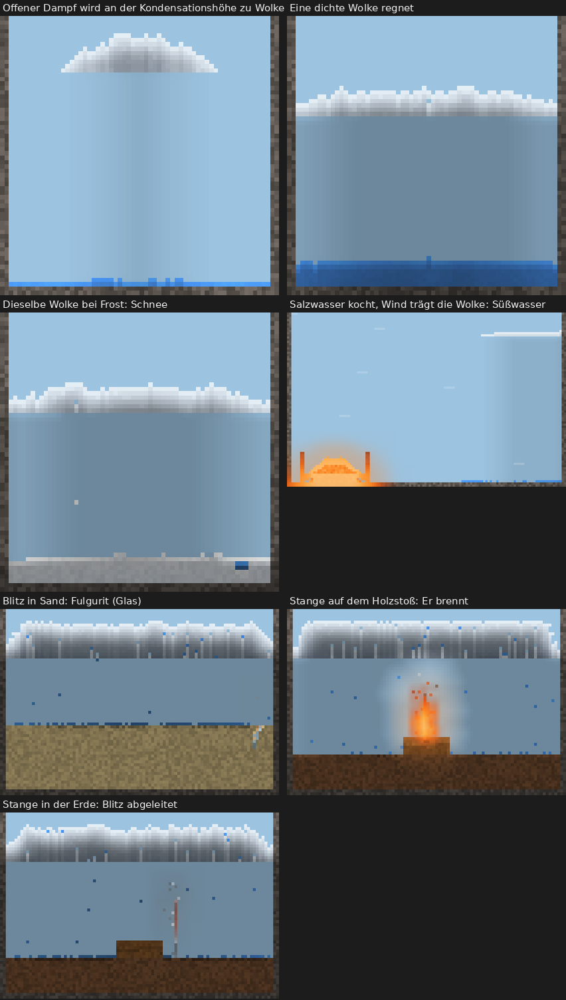
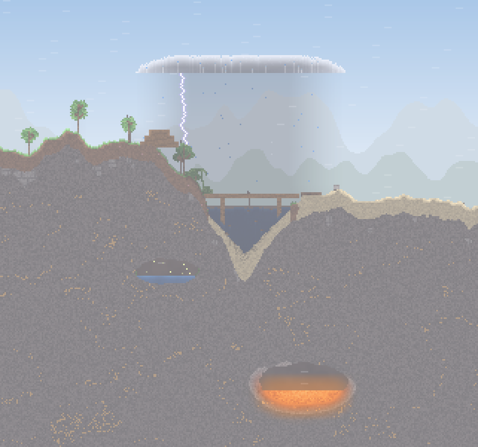
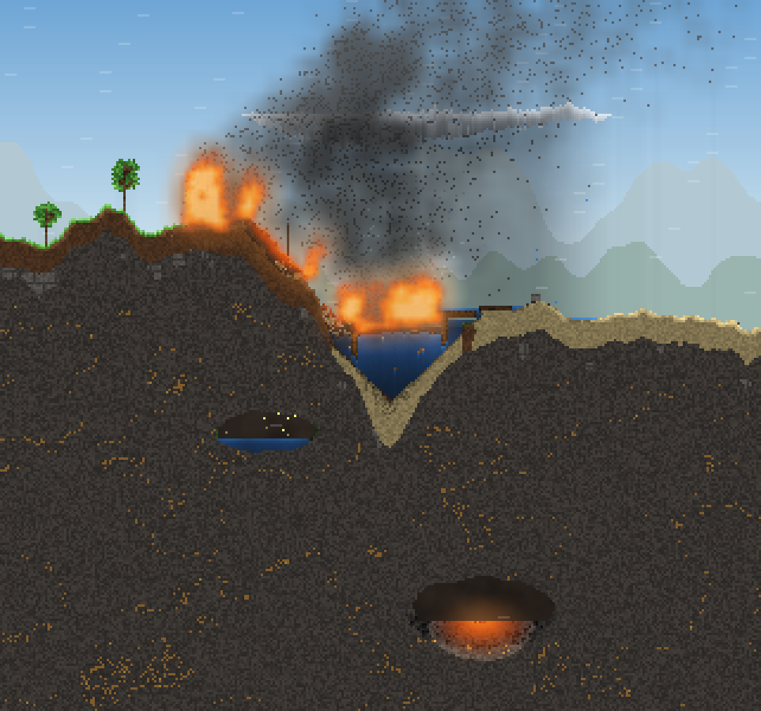

# Phase 3c: Bericht

Phase 3c nach 3b, vor Phase 4: Atmosphäre und Wetter. Wolken, Regen und Schnee, Wind, Gewitter mit Blitzen, Wetter im Level-Format und in den Vorlagen, Wetterregler im Spielplatz. Phase 4 ist nicht begonnen.

**Build:** [`beta-98`](https://github.com/shootcat/ReAct/releases/tag/beta-98), APK und Screenshots dort.
- beta-97 war rot, nur am neuen App-Test: Er suchte den Menüeintrag „Wetter …“ über ein Test-Tag und fand ihn nicht. Simulation, Level und alle übrigen App-Tests waren grün, die App kompilierte. Der Test sucht den Eintrag jetzt wie die anderen Tests über seinen Text, wartet kurz und zeigt bei einem Fehlschlag den ganzen Bildschirm.

## 1. Dampf, Kondensationshöhe, Wolken

- **Neues Material „Wolke“** (`cloud`): ein Gas, doppelt so dicht wie Dampf und so dicht wie Luft (es schwebt, statt zu steigen), weiß, zu 80 % lichtdurchlässig. Im Spielplatz liegt es unter „Flüssig“ neben Dampf.
- **Kondensationshöhe** (`cloud_base`): eine Zeile pro Welt.
  - Im Level steht sie in der `level.json`.
  - In den Vorlagen hängt sie von der Landschaft ab: Wiese, Feld, Insel, Küste und Vulkan auf 16 % der Höhe von oben, der Berg auf 20 %, das Höhlensystem auf 10 %.
  - Ohne Kondensationshöhe gibt es keine Wolken, und alles läuft wie vor 3c.
- **Dampf im Freien** kühlt beim Steigen ab, 0,3 °C pro Zeile. Ab der Kondensationshöhe wird er zu Wolke, nicht zu Wasser. Darunter kondensiert er nur an kalten Flächen (unter 60 °C), etwa an einem kalten Felsüberhang.
- **Dampf in geschlossenen Höhlen** kondensiert wie bisher an den kalten Wänden, auch wenn die Welt eine Kondensationshöhe hat. Geschlossen heißt: kein Weg zum Himmel. Das prüft dieselbe Raumerkennung wie für den Druck.
- **Wolken ballen sich:** Unter der Kondensationshöhe steigt Wolke auf. Darüber sinkt sie, solange Luft unter ihr ist, und rutscht schräg von anderer Wolke ab. So bilden sich Haufen an der Kondensationshöhe statt Eiszapfen. Neuer Dampf, der von unten kommt, legt sich oben auf den Haufen.
- **Auflösen:** Ein einzelner Fetzen ohne Nachbarn löst sich langsam auf. Ohne Kondensationshöhe (Wolken im Spielplatz ausgeschaltet) verschwinden alle Wolken nach und nach.
- Gemessen (`WeatherTest`): Offener Dampf (288 Zellen) wird in 15 s zu 217 Zellen Wolke, 71 Zellen sind schon als Regen gefallen. Ohne Kondensationshöhe werden daraus wie früher 288 Zellen Wasser. In einer geschlossenen Höhle mit Kondensationshöhe entsteht keine Wolke.

## 2. Regen und Schnee

- Eine Wolkenzelle mit mindestens 7 Wolkennachbarn (von 8) regnet: Alle 10 Schritte wird sie mit 0,6 % zu einem Tropfen Wasser, der fällt.
- Hat die Wolke Frost (0 °C oder kälter), fällt Schnee. Wolken nehmen wie offene Luft langsam die Lufttemperatur an; im Spielplatz macht der Temperaturregler unter 0 °C aus Regen Schnee.
- Regen ist immer **Süßwasser**. Beim Verdampfen von Salzwasser bleibt das Salz zurück, der Dampf ist Wasserdampf.
- Gemessen: Eine Wolke von 676 Zellen gibt in 30 s 358 Zellen Wasser. Dieselbe Wolke bei Frost gibt 358 Zellen Schnee.
- Salzwasser, das über Magma kocht, bei leichtem Wind (0,15): Nach 180 s sind neben dem Becken 28 Zellen Süßwasser gefallen und keine Zelle Salzwasser. Im Becken liegen 66 Zellen Salz.

## 3. Wind

- **Feld pro Welt:** Richtung und Stärke (−1 bis 1, plus nach rechts), dazu Böen.
  - Die Böen sind eine Dreieckswelle um den Grundwind, mit fester Dauer (Level: `gust_seconds`, Spielplatz: 10 s). Sie hängen nur von der Schrittnummer ab und sind damit ohne Zufall.
- **Was der Wind trägt,** steht pro Material in `materials.json` (`wind`, 0 bis 1): Rauch 1, Dampf 0,9, Asche 0,85, Grubengas 0,8, Feuer und totes Laub 0,6, Schnee 0,55, Glut 0,35, Sand 0,2.
  - Gase im Freien wandern mit dem Wind, Zelle für Zelle. Am Rand der Welt weht er sie hinaus.
  - **Wolken ziehen als Ganzes:** Zuerst hatte der Wind jede Wolkenzelle einzeln mitgenommen. Damit zog er jede Wolke zu einem Streifen aus, eine Zelle dünn, und der regnete nie (gefunden im Test mit Salzwasser). Jetzt rückt das ganze Wolkenband eine Spalte weiter, sobald der Wind genug Weg gesammelt hat: bei Wind 1 sechs Spalten pro Sekunde, bei 0,15 etwa eine. Das geht ohne Zufall. Vor einer Wand oder einem Berg staut sich die Wolke und regnet dort ab. Gemessen: Eine Wolke von 30 × 9 Zellen zieht bei Wind 0,5 in 10 s 30 Spalten weit und ist danach 38 Spalten breit.
  - Pulver wird erst getragen, wenn der Wind stärker ist als 1 minus sein Windwert. Sand fliegt also erst ab 0,8, Schnee ab 0,45, Asche schon ab 0,15.
  - Nur trockene, nicht verankerte Körner an der Oberfläche fliegen; nasser Sand bleibt liegen.
  - Gemessen (Verschiebung des Schwerpunkts): Rauch bei Wind 0,6 21,2 Zellen in 1 s (windstill 0,6). Schnee bei 0,7 und Asche bei 0,4 je 4,0 Zellen in 3 s. Sand bei 0,7 nichts, bei 1,0 3,8 Zellen, nass bei 1,0 nichts.
- **Feuer:** Der Wind trägt warme Luft mit (wie warme Luft aufsteigt, nur seitlich), und die Flammen eines brennenden Stoffs schlagen bevorzugt in Windrichtung.
  - Gemessen: Ein Teppich aus totem Laub, in der Mitte angezündet, brennt bei Windstille gleichmäßig nach beiden Seiten (23 links, 22 rechts verbrannt). Bei Wind 0,35 nach rechts brennen rechts 33 Zellen, links 19.
- **Sichtbar:**
  - Wolken ziehen, ihre Unterseite ist dunkler als die Oberseite.
  - Grashalme hellen in einer laufenden Welle auf; je stärker der Wind, desto schneller läuft sie, in Windrichtung.
  - Ab Wind 0,15 ziehen feine helle Streifen durch die offene, helle Luft.
  - Rauch, Asche und Schnee treiben sichtbar mit.

## 4. Gewitter

- **Wann:** Unter einer Wolkendecke, die mindestens 24 Zellen breit und im Mittel 6 Zellen tief ist, kann alle 10 Schritte ein Blitz fallen. Die Wahrscheinlichkeit ist 2 %, während eines ausgelösten Gewitters 12 %, mit mindestens 1,5 s Pause zwischen zwei Blitzen.
- **Wohin:** Unter der Decke wird jede Spalte bis zum ersten festen Halt abgesucht. Fallende Tropfen und Gase zählen nicht. Bewertet wird die Höhe (2 Punkte pro Zeile), dazu Metall +60, Baumkrone und Stamm +24, Wasser +10, Nasses +4. Metall zieht den Blitz also auch dann an, wenn es bis zu 30 Zeilen tiefer liegt als der höchste gewöhnliche Boden, oder bis zu 18 Zeilen tiefer als eine Baumkrone.
- **Metall leitet ihn:** Trifft der Blitz Metall, läuft der Strom durch alles Metall, das daran hängt (bis 600 Zellen), und erhitzt es um 700 °C. Am unteren Ende geht er in den Untergrund, und dort wirkt er wie ein Einschlag. Steht eine Stange in der Erde, passiert dort nichts Besonderes: Sie ist ein Blitzableiter. Steht sie auf einem Holzstoß, brennt der Holzstoß. Ohne diese Regel hätte der Blitz nur die Spitze der Stange erhitzt. Im Labor wurde Holz neben einer 760 °C heißen Stange höchstens 111 °C warm und fing nie Feuer; ein Blitzableiter als Feuerquelle (Punkt 8) wäre so nicht möglich gewesen.
- **Was er tut:**
  - Die Luft rund um den Einschlag (5 × 5 Zellen) wird 900 °C heiß.
  - In den 3 × 3 Zellen um den Einschlag: Metall wird um 700 °C heißer, Brennbares wird 300 °C über seinen Zündpunkt gebracht und brennt, Wasser wird 160 °C heiß und verdampft zum Teil, alle anderen Stoffe außer dem Gelände (Fels, Erzader, Magma) werden 900 °C heiß.
  - Sand schmilzt zu einer Glasröhre, bis zu 8 Zellen tief und mit Ästen (Fulgurit). Liegt eine Pfütze auf dem Sand, geht der Fulgurit durch bis zu 4 Zellen Flüssigkeit in den Sand darunter.
- **Licht und Ton:** Der Blitz ist ein gezackter Kanal mit weißem Kern und violettem Rand, 8 Schritte lang zu sehen. Die ganze Welt wird 10 Schritte lang aufgehellt. Dazu kommt Donner, ein neuer Klang: harter Knall, dann ein langes Grollen.
- Gemessen:
  - Eine Metallstange zwischen höherem Sand wird getroffen und ist danach 720 °C heiß.
  - Ein Blitz in Sand gibt 8 Zellen Glas.
  - Ein Holzpfahl unter einem Gewitter brennt nach dem Einschlag mit 11 Zellen.
  - Eine Stange auf einem Holzstoß wird getroffen; 0,5 s später brennen 4 Zellen Holz. Dieselbe Stange daneben in der Erde: kein Feuer.

## 5. Determinismus

- **Im Level gibt es keinen Zufall im Wetter.** Der Wind ist fest, die Böen sind eine feste Welle.
- Regen und Blitze kommen nur aus Wolken, die im Gelände gemalt sind oder durch Dampf im Spiel entstehen. Ihre Würfel kommen aus dem einen Zufallsgenerator der Welt, in fester Reihenfolge. Derselbe Seed und dieselben Aktionen ergeben auf jedem Gerät dieselben Blitze an denselben Stellen.
- **Zufallswetter nur im Spielplatz** und nur, wenn es eingeschaltet ist („Eigenes Wetter“). Dann dreht der Wind alle 10 s ein wenig, mit Böen. Sind Wolken eingeschaltet, ziehen außerdem in 34 % der Fälle Wolkenbänke auf, in 6 % ein Gewitter. Auch das läuft über den Generator der Welt und ist mit dem Protokoll wiederholbar.
- **Undo und Protokoll:** Das Wetter gehört zum Schnappschuss (Wind, Böen, Höhe, Temperatur, Gewitter). Wetteränderungen und „Gewitter auslösen“ sind Eingaben im Protokoll und werden beim Abspielen wiederholt.
- Tests: `DeterminismTest` (alle grün), `WeatherTest` („gusts are a fixed rhythm, and the weather goes back with an undo“).
- **Level 1 bis 3** bleiben ohne Wetter: kein Wind, keine Wolken. Ihre Wege und Medaillen gelten unverändert; die Lösungstests sind grün.

## 6. Spielplatz: Wetterregler

- Menü → **Wetter …**:
  - Wind (−10 bis 10, links bis rechts, in Schritten von 1),
  - Böen an/aus,
  - Lufttemperatur −20 bis 40 °C,
  - Wolken an/aus,
  - Eigenes Wetter an/aus,
  - **Gewitter auslösen**.
- „Übernehmen“ ist ein Handgriff und lässt sich rückgängig machen.
- „Gewitter auslösen“ legt über der Mitte des Bildschirms eine breite, 12 Zellen tiefe Wolkenbank an die Kondensationshöhe. Für 30 s kommen die Blitze häufiger. Sind die Wolken aus, werden sie dafür eingeschaltet.
- Die Temperatur gilt für die offene Luft: Sie nimmt sie langsam an, ebenso die Wolken. Eingeschlossene Luft behält ihre Wärme.
- Im Level gibt es den Menüpunkt nicht.
- Screenshots: `40_wetter` (Regler), `41_gewitter_blitz`, `42_gewitter_regen`.

## 7. Leistung

Gemessen auf diesem Rechner (JVM, etwa 2,5-mal langsamer als das Galaxy Z Fold2), in ms pro Schritt.

**3b gegen 3c**, abwechselnd gemessen, je drei Läufe, derselbe Benchmark wie im 3b-Bericht. Die Welten haben kein Wetter; gemessen wird also, was der neue Code kostet, wenn kein Wetter ist, zusammen mit der Optimierung der Luftschleife.

| Welt | 3b | 3c | Median |
|---|---|---|---|
| Voll aktive Welt 200 × 350 | 5,78 / 5,06 / 4,76 | 5,30 / 5,19 / 4,64 | 5,06 → 5,19 (+3 %) |
| dieselbe mit Pflanzen, Tieren und Licht | 5,97 / 5,16 / 5,69 | 5,82 / 5,02 / 5,30 | 5,69 → 5,30 (−7 %) |
| Spielplatz 200 × 350 | 2,84 / 2,52 / 2,82 | 2,78 / 2,43 / 2,20 | 2,82 → 2,43 (−14 %) |
| Größte Welt 600 × 340, voll aktiv | 18,01 / 16,45 / 15,36 | 16,22 / 15,53 / 16,28 | 16,45 → 16,22 (−1 %) |
| Größte Welt, voll aktiv mit Pflanzen, Tieren und Licht | 20,36 / 17,98 / 18,02 | 18,49 / 20,05 / 17,00 | 18,02 → 18,49 (+3 %) |
| Größte Welt, Wiese mit Feuer, Sand und Wasser | 3,05 / 2,54 / 2,82 | 2,99 / 2,95 / 2,87 | 2,82 → 2,95 (+5 %) |

- Die Läufe streuen um etwa ±10 %. Im Rahmen dieser Streuung ist 3c so schnell wie 3b.

**Die Luftschleife** (`heat`) wurde wie in 3b angekündigt umgebaut:
- Zuerst wird gefragt, ob zwei Nachbarn überhaupt verschieden warm sind. Das ist bei den meisten Paaren nicht so. Erst danach kommen die Fragen nach warmer Luft, Wind und Decke.
- Luft, die schon die Umgebungstemperatur hat, wird übersprungen, ohne nachzusehen, ob sie eingeschlossen ist.
- Ist ein Chunk schon als warm erkannt, wird die Weckprüfung nur noch an seinem Rand gerechnet.
- Das Ergebnis ist Zelle für Zelle dasselbe wie vorher; alle Level-Lösungen sind unverändert.
- Gemessen mit einem Stichproben-Profil (größte Welt, voll aktiv), Anteil und ms pro Schritt für die Wärme:

  | | vor 3b | 3b | 3c |
  |---|---|---|---|
  | Wärme | 31 % = 4,40 ms | 35 % = 5,25 ms | 33 % = 4,95 ms |
  | Schritt gesamt | 14,18 ms | 15,00 ms | 14,99 ms |

- Die Optimierung holt etwa ein Drittel der Mehrkosten der warmen Luft zurück; dafür kommt das Wetter dazu, und der Schritt bleibt auf dem Stand von 3b.
- Mehr ließe sich nur holen, wenn die Wärme ohne Verzweigungen gerechnet würde. Dann ändern sich aber die Zahlen in der letzten Stelle, und mit ihnen die gemessenen Wege und Medaillen der Level. Das wäre ein eigener Schritt mit neuer Messung aller Level; ich schlage ihn für Phase 4 vor, wenn ohnehin neu gemessen wird.

**Was Wetter kostet**, größte Welt, dieselbe Wiese mit Feuer, Sand und Wasser, ohne und mit Wind 0,5 mit Böen, Wolken und einem Gewitter über der Mitte:

| | ohne Wetter | mit Wetter |
|---|---|---|
| Schritt | 2,58 ms (54 von 209 Chunks wach) | 3,37 ms (76 von 209 Chunks wach) |
| Bild, sichtbares Drittel | 2,43 ms | 2,96 ms |

- Das Wetter selbst (Wolkenband, Wolken ziehen, Regen auslösen, Blitze suchen) liegt im Profil unter 1 %. Die Mehrkosten kommen daher, dass mehr los ist: fallender Regen, Feuer nach Blitzen, mehr wache Chunks.
- Diese Welt ist jetzt auch Teil von „Leistung messen“ in der App und des CI-Benchmarks.
- **Hochgerechnet auf das Fold2:**
  - Größte, voll aktive, belebte Welt: 18,5 ms / 2,5 ≈ 7,4 ms, knapp unter der Grenze von 8 ms (wie in 3b).
  - Größte Welt mit Wetter: 3,37 ms / 2,5 ≈ 1,35 ms pro Schritt, dazu etwa 1,2 ms pro Bild.
  - Den gültigen Wert liefert „Leistung messen“ auf dem Gerät.

## 8. Vorschlag: Level 4

Nur das Konzept; gebaut wird nach Freigabe.

### „Gewitterfeuer“ (empfohlen): Der Blitzableiter als Feuerquelle

- **Ziel:** Entzünde den Holzstoß auf dem Felsplateau. Im ganzen Level gibt es keine Flamme, keine Glut und keine Lava. Über dem Tal hängt eine schwere Gewitterwolke; der Blitz ist die einzige Feuerquelle.
- **Was von selbst passiert:** Der Blitz trifft den höchsten Punkt, den hohen Baum auf dem Hügel links, oder den See. Der Holzstoß rechts bleibt kalt.
- **Die Einsicht:** Der Blitz sucht Metall, läuft durch das Metall und schlägt an dessen unterem Ende in den Untergrund. Eine Metallstange, die *auf* dem Holzstoß steht, holt den Blitz genau dorthin und zündet ihn. Eine Stange, die *im Boden* steckt, leitet ihn harmlos ab (ein echter Blitzableiter).
- **Welt** (etwa 220 × 140, Hochland):
  - links ein Hügel mit einem hohen Baum, dem höchsten Punkt,
  - in der Mitte ein See,
  - rechts ein Felsplateau mit dem Holzstoß als Zielbereich,
  - am Hang ein umgestürzter Zaun aus kurzen Metallstangen. Die Hand trägt bis zu 15 Zellen Metall (`MAX_LOAD`); das reicht, wenn der Holzstoß höchstens etwa 30 Zeilen tiefer liegt als die Baumkrone.
  - oben eine gemalte Wolkenbank über die ganze Breite, Kondensationshöhe fest, kein Wind.
- **Wege** (je ein Lösungstest, Grenzen nach dem Bau gemessen):
  - Gold: eine Stange aus dem Zaun nehmen und senkrecht auf den Holzstoß stellen; 2 Handgriffe.
  - Silber (beim Bau zu prüfen): eine Spur aus trockenem Laub oder Holz vom Baum hinüber zum Holzstoß. Der Blitz zündet den Baum, und das Feuer läuft die Spur entlang; das kostet mehr Zeit und mehr Griffe. Glut mit dem Eimer zu tragen geht nicht, denn der Eimer nimmt nichts, was brennt.
  - Falle: Stange neben dem Stoß in den Boden stecken. Der Blitz fährt sichtbar in die Stange, und nichts brennt. Daraus lernt man, wohin der Strom geht.
- **Determinismus:** Die Wolke ist gemalt und der Wind fest. Die Blitze kommen aus der Wolke über den Zufallsgenerator der Welt; derselbe Seed und dieselben Handgriffe ergeben dieselben Einschläge.
- **Labor (`ZLabL4`, 200 × 120, Wolkenbank 12 Zeilen tief über der ganzen Breite, je 60 s):**

  | Aufbau | Einschläge | Holzstoß |
  |---|---|---|
  | ohne Stange | Baumkrone, See, Erde am Hügel | bleibt kalt (21 °C) |
  | Stange (20 Zellen) auf dem Holzstoß | 2 in die Stange (dazu 2 in den Baum) | brennt 2,0 s nach Beginn, nach 60 s sind 66 von 96 Zellen verbrannt |
  | Stange durch den Holzstoß bis in den Fels | 1 in die Stange | verkohlt erst innen, brennt nach 4,2 s |
  | Stange neben dem Stoß im Fels (geerdet) | 1 in die Stange | brennt nicht, das Holz wird 85 °C warm |
  | kurze Stange (12 Zellen) auf dem Stoß | keiner in 60 s | brennt nicht |

  Dazu der feste Test `WeatherTest` („lightning runs down a metal rod and goes to ground at its foot“): Stange auf dem Holzstoß: 4 Zellen Holz brennen 0,5 s nach dem Einschlag. Stange in der Erde daneben: keine.
- **Offen, vor dem Bau zu klären:**
  - Eine Wolkenbank regnet sich in etwa einer Minute zur Hälfte ab. Damit das Gewitter anhält, braucht das Level entweder eine sehr dicke Bank oder eine kleine Erweiterung des Formats: `"storm_seconds"` in `weather`, also ein Gewitter wie im Spielplatz, aber fest im Level, ohne Zufallswetter.
  - Der Regen macht Holz nass, und nasses Holz brennt nicht. Im Labor waren nach 30 s höchstens 9 von 96 Zellen nass, und das Feuer kam trotzdem. Ein Felsüberhang über einem Teil des Stoßes könnte daraus eine zweite, kleine Einsicht machen.

### Alternative: „Regenmacher“ (Wolken und Wind)

- Ein trockenes Feld soll grün werden (Ziel: Gras im Zielbereich). Es gibt nur Salzwasser, und Salzwasser tötet Gras.
- Am Rand liegt ein Lavaschlot. Salzwasser auf der Lava verdampft, das Salz bleibt liegen. Der Dampf steigt zur Kondensationshöhe und wird Wolke. Der feste Wind trägt sie als Ganzes über das Feld, und dort regnet sie Süßwasser.
- Einsicht: Verdampfen trennt Wasser vom Salz, und Wolken wandern mit dem Wind.
- Gemessen (`WeatherTest`): Salzwasser, das über Magma kocht, gibt bei Wind 0,15 neben dem Becken 28 Zellen Süßwasser und kein Salzwasser.

## Entdeckungsbuch

Acht neue Einträge, jeder mit kleiner Szene samt Wetter:
- Dampf wird hoch oben in der kühlen Luft zu Wolken.
- Wolke regnet ab, wenn sie dicht genug ist; Wolke schneit bei Frost.
- Sand wird trocken vom starken Wind verweht; Schnee wird vom Wind verweht; Asche wird schon von leichtem Wind fortgetragen.
- Metall zieht Blitze an.
- Sand wird vom Blitz zu Glas geschmolzen.

Alle 70 Szenen zeigen ihre Eigenschaft innerhalb von 20 s (`DiscoveryTest`).

## Tests

- `sim` und `level`: 168 Tests, alle grün (lokal, vor dem Push).
- Neu: `WeatherTest` mit 12 Tests und einem Bildertest:
  - offener Dampf wird zu Wolke, nicht zu Wasser;
  - in der geschlossenen Höhle kondensiert er wie bisher;
  - eine dichte Wolke regnet, bei Frost schneit sie;
  - Salzwasserdampf regnet als Süßwasser;
  - Wolken ziehen als Ganzes;
  - der Wind trägt Rauch, Schnee und Asche, Sand nur im Sturm, nassen Sand nie;
  - Feuer läuft mit dem Wind;
  - Blitz in Metall statt in höheren Sand;
  - Blitz läuft durch die Stange in den Holzstoß, eine geerdete Stange schützt;
  - Fulgurit im Sand, brennender Holzpfahl;
  - Wolken lösen sich ohne Kondensationshöhe auf;
  - Böen als fester Rhythmus, Wetter mit Undo.
- `DiscoveryTest`: 70 Szenen, davon 8 neue mit Wetter.
- App-Test `weatherControlsAndStorm`:
  - Menü → Wetter …, Wind 6 nach rechts mit Böen übernehmen (geprüft am Zustand der Welt),
  - Gewitter auslösen,
  - warten, bis ein Blitz auf dem Bildschirm ist, und ihn aufnehmen,
  - dann den Regen aufnehmen.
  - Screenshots `40_wetter`, `41_gewitter_blitz`, `42_gewitter_regen`.

## Bilder

Gewitter über der Wiese (480 × 300, Wind 0,4 mit Böen): der erste Blitz schlägt in den Baum am Hang, die ganze Welt ist kurz aufgehellt.

Zehn Sekunden später: Der Baum und die Brücke brennen, der Wind trägt den Rauch nach rechts, die Wolkenbank hat sich zum Teil abgeregnet und zieht weiter.

