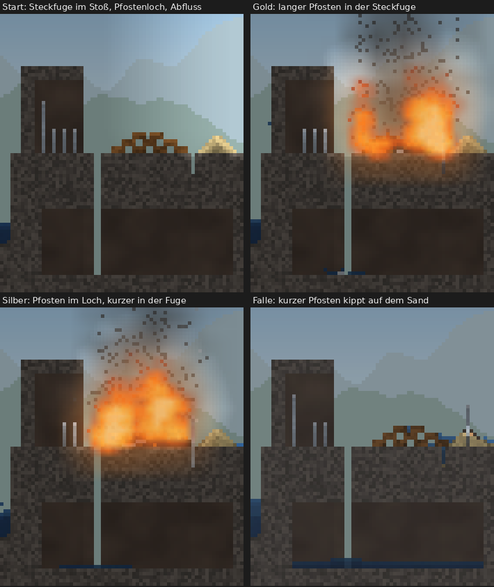
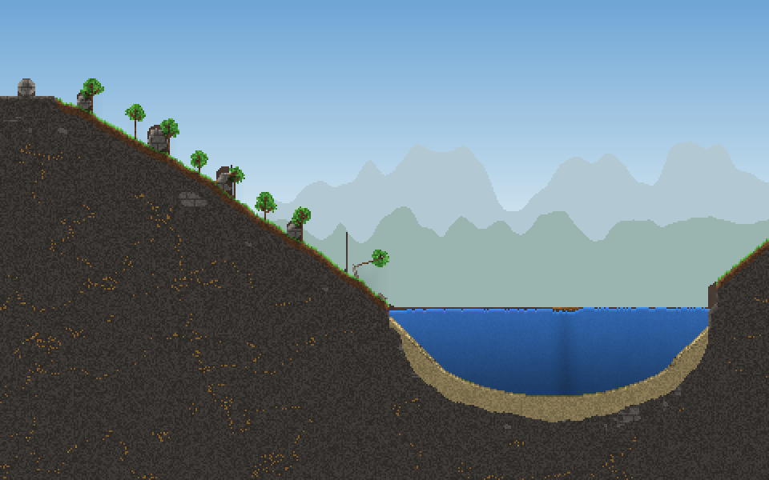
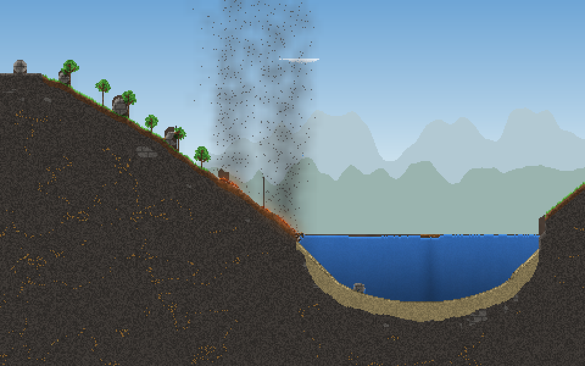
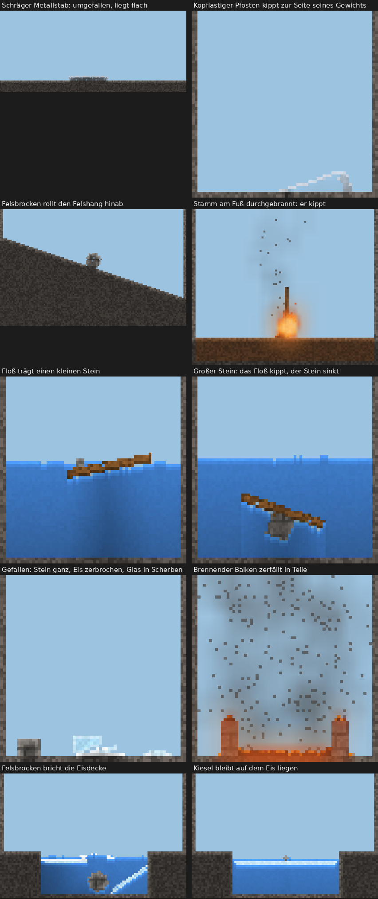

# Phase 4: Bericht

Phase 4, schlanke Fassung: Körperphysik. Lose Strukturen sind jetzt starre Körper. Sie fallen, kippen, drehen sich, rollen, schwimmen oder sinken nach ihrer Dichte und zerbrechen bei harten Stößen. Dabei bleiben sie Zellen der Materialwelt. Phase 5 (Bewohner) ist nicht begonnen.

**Build:** [`beta-105`](https://github.com/shootcat/ReAct/releases/tag/beta-105), APK, Screenshots und Messwerte des CI-Rechners dort. Die Zwischenstände `beta-103` und `beta-104` waren ebenfalls grün.

## 1. jbox2d oder eigene Lösung

**Entscheidung: ein eigener Löser auf dem Zellraster** (`sim/Bodies.kt`, etwa 1700 Zeilen, ohne neue Abhängigkeit).

Gründe gegen jbox2d:
- **Körper bleiben Zellen.** Ein Stamm brennt Zelle für Zelle ab, Glas springt an einer Stelle, Eis schmilzt am Rand. jbox2d kennt nur Polygone. Jede geänderte Zelle hieße: Form neu in konvexe Polygone zerlegen, Masse und Trägheit neu rechnen, Körper im Löser neu anlegen. Bei einem Brand passiert das in jedem Schritt an vielen Körpern.
- **Das Gelände ändert sich ständig.** Sand rieselt, Lava erstarrt, Erde wird weggespült, Schnee verdichtet sich. Für jbox2d müsste der Boden in jedem Schritt als Kantenzug nachgeführt werden, für jeden geänderten Chunk. Im eigenen Löser ist der Boden das Raster selbst: Ein Körper stößt an das, was in den Zellen steht.
- **Schwimmen und Verdrängen** gibt es in jbox2d nicht. Der Auftrieb hängt davon ab, welche Flüssigkeit in welcher Zeile neben dem Körper steht (Wasser, Salzwasser, Lava, flüssiges Metall). Ein Körper, der sich bewegt, muss Wasser und leichten Schutt Zelle für Zelle verdrängen. Beides müsste ohnehin auf dem Raster gebaut werden.
- **Undo und Wiedergabe.** jbox2d hält inneren Zustand, den man nicht sichern kann: Kontakte, Impulse für den Warmstart, den Baum der Breitphase. Nach einem Undo müsste die Welt neu aufgebaut werden. Dann rechnet der Löser ohne die alten Kontakte weiter, und die Körper laufen anders als ohne Undo. Der eigene Löser hat keinen solchen Zustand. Lage, Geschwindigkeit und ein paar Zähler je Körper gehören zum Schnappschuss, und nach einem Undo läuft alles genau wie vorher.
- **Determinismus über Geräte:** Der eigene Löser rechnet nur mit +, −, ×, ÷ und der Quadratwurzel; die IEEE-Norm schreibt für alle fünf die Rundung genau vor. Sinus und Kosinus kleiner Drehungen kommen aus wenigen Gliedern ihrer Reihe. Das Ergebnis ist auf jedem Gerät dasselbe.
- **Pflege:** Die letzte Version von jbox2d (2.2.1.1) ist von 2014.
- **Der Bedarf ist bescheiden:** keine Gelenke, Seile oder Hebel in dieser Phase (siehe Abschnitt 9).

Was der eigene Löser schlechter kann als jbox2d (ehrlich):
- Kontakte sind so grob wie das Raster. Runde Körper rollen etwas holprig, und ein Körper liegt immer auf Zellkanten auf.
- Hohe Stapel aus vielen Körpern sind weicher. Zwei Pfosten von einer Zelle Breite stehen nicht übereinander, und ein Pfosten steht nicht auf einer einzelnen Zelle.
- Es gibt keine Gelenke.

## 2. Was ein Körper ist

- **Jede lose Struktur ist ein Körper.** Bis 3c fiel sie als Ganzes senkrecht nach unten und konnte sich nicht drehen; jetzt hat sie:
  - Lage (Schwerpunkt und Drehwinkel), Geschwindigkeit und Drehgeschwindigkeit,
  - Masse aus der Dichte ihrer Zellen (`density` / 1000 je Zelle) und das Trägheitsmoment aus den Zellen.
- **Die Zellen bleiben im Raster.** Ein Körper wird in Teilschritten bewegt, je höchstens eine halbe Zelle (bis zu 16 Teilschritte pro Schritt). Nach jedem Teilschritt wird er neu ins Raster gezeichnet. Jede Zelle nimmt Material, Temperatur, Nässe, Brennen und Aussehen mit. Feuer, Wärme, Licht und Wasser wirken auf Körperzellen wie auf alle anderen.
- **Stoßen:** Trifft die neue Lage auf Festes, entsteht an jeder Berührung eine Kontaktnormale aus den 3 × 3 Zellen um sie. Die Kontakte einer Fläche werden zu höchstens zwei Punkten zusammengefasst. Gelöst wird mit Impulsen und Reibung, acht Runden, mit einem Paar-Löser für zwei Punkte, der einen aufliegenden Balken ruhig hält.
  - **Reibung** steht pro Material in `materials.json` (`friction`). Fels, Stein, Basalt und Ziegel 0,7; Holz, Stamm und Totholz 0,6; Metall 0,35; Glas 0,3; Eis 0,05. Es zählt die kleinere der beiden Reibungen.
  - **Rückprall:** ab 1,2 Zellen pro Schritt mit einem Fünftel der Geschwindigkeit.
- **Was ein Körper durchquert oder verdrängt:**
  - Luft, Gas und Flüssigkeit: Sie werden verdrängt.
  - Tiere.
  - Laub und Ranken, außer für Pflanzenkörper.
  - Leichter Schutt (Asche, Holzkohle, Glut, totes Laub), wenn der Körper mindestens dreimal so dicht ist. Ein Felsbrocken schiebt so die Holzkohle eines verbrannten Baums beiseite und rollt weiter.
  - Schnee trägt, außer frisch gefallener, lose treibender Schnee.
- **Schlafen:** Liegt ein Körper 20 Schritte ruhig und langsam, schläft er und kostet fast nichts. Er wacht auf, wenn sich um ihn etwas ändert, wenn ihn etwas schneller als 0,6 Zellen pro Schritt trifft, oder durch eine Explosion.
- **Teilen und Verbinden:**
  - Wird ein Körper getrennt (abgebrannt, geschmolzen, zerbrochen, gesprengt), wird jedes Teil ein eigener Körper. Es behält die Bewegung, die es am alten Körper hatte.
  - Neues Festes, das an einem Körper entsteht, gehört zu ihm, zum Beispiel Eis, das an einer treibenden Scholle anfriert.
  - Körper, die 8 Schritte lang ruhig aneinander liegen, werden ein Körper.
- **Verankern:** Ein ruhender Körper, den verankertes Gelände hält, wird wieder ein fester Teil der Welt (eine Struktur wie bisher).
  - Was hält: Fels darüber (Decke); Fels daneben nur, wenn er als Wand höher reicht und die Zelle nicht auf Boden darunter liegt; Fels darunter nie.
  - **Geändert gegenüber 3c:** Bis 3c galt alles, was Fels berührte, als verankert. Deshalb blieb schräg gesetztes Metall auf Fels schräg stehen (3c, Abschnitt 10). Jetzt liegt ein Körper auf Fels lose: Er kippt und rollt. Ein Block, der in einem Schacht klemmt, ist danach fest (Test „wedged between rock walls“).
- **Wurzeln:**
  - Ein lebender Stamm auf festem Boden (Erde, Sand, Kies, Lehm: Pulver ab Dichte 1200) steht durch seine Wurzeln, ebenso eine Ranke an festem Boden oder an einer gebauten Wand.
  - Brennt ein Stamm am Fuß durch, verliert der obere Teil den Halt, wird ein Körper und kippt um.
  - Ein umgestürzter Stamm, der auf Erde zu liegen kommt, wurzelt wieder. Die Hand kann ihn trotzdem nehmen, wie bisher.

## 3. Schwimmen

- **Auftrieb Zeile für Zeile:** Für jede Zeile eines Körpers zählt die Flüssigkeit an ihren Enden mit ihrer Dichte. So liegt ein Körper, der in Lava und flüssigem Metall zugleich steckt, richtig. Die Wasserlinie wird stetig gerechnet, damit ein Floß ruhig liegt und nicht um eine Zelle springt. Dazu kommt ein Widerstand in der Flüssigkeit (10 % pro Schritt, ganz eingetaucht).
- **Ergebnis nach Dichte:**
  - Holz (650) schwimmt, etwa zwei Drittel unter Wasser; Eis (917) schwimmt fast ganz eingetaucht.
  - Stein (2600) und Metall (7800) sinken in Wasser.
  - In Lava (2600) sinkt Basalt (2900). Glas (2500) schwimmt zu 96 % eingetaucht.
- **Gemessen** (`BodyTest`):
  - Ein Floß aus 30 × 3 Zellen Holz trägt einen Stein von 3 × 3; seine Unterkante bleibt über Zeile 40, der Grund liegt bei 61.
  - Ein Stein von 8 × 8 kippt das Floß und sinkt bis unter Zeile 50.

## 4. Zerbrechen

- **Der Körper selbst** bricht, wenn ½ · Aufprallgeschwindigkeit² größer ist als 0,25 × Festigkeit². Die Festigkeit (`strength`) gibt es seit 2d für den Druck: Glas 2, Eis 4, Ziegel 6, Stein und Basalt 9.
  - Daraus folgt: Glas bricht ab etwa 5 Zellen Fallhöhe, Eis ab etwa 20, Ziegel ab etwa 45.
  - Stein und Basalt brechen beim Fallen nie: Die Höchstgeschwindigkeit von 6 Zellen pro Schritt reicht nicht.
  - Holz und Metall haben kein Bruchprodukt und zerbrechen nicht.
- **Was getroffen wird,** bricht, wenn die Stoßenergie (½ · reduzierte Masse · Geschwindigkeit²) größer ist als 8 × seine Festigkeit².
- **Wie es bricht:**
  - Um den Aufschlag wird ein Kern zum Bruchprodukt: Glas zu Glasscherben, Eis zu Schnee (zerstoßenes Eis), Stein, Basalt und Ziegel zu Geröll.
  - Dazu kommen bis zu vier Risse; was zwischen ihnen liegt, wird zu eigenen Körpern.
  - Kleine Körper zerbrechen ganz.
- **Thermoschock (2d):** Heißes Glas, das abgeschreckt wird, springt jetzt auch durch einen Glaskörper als Riss, nicht nur an der berührten Zelle. Ohne das blieb das Glas in Level 3 ganz und schwamm in der Lava, statt zu Scherben zu werden.
- **Eine harte Landung** erschüttert den Boden: Schnee am Hang löst sich (Lawine aus 2d).
- **Gemessen** (`BodyTest`):
  - Glas aus gut 50 Zellen Höhe zerspringt (32 Zellen werden zu mindestens 30 Zellen Scherben); aus zwei Zellen Höhe abgesetzt, bleibt es ganz.
  - Stein (48 Zellen) übersteht einen ebenso hohen Fall ganz. Eis zerbricht in mindestens zwei Körper und etwas Schnee.
  - Ein Felsbrocken (Radius 5) bricht die zwei Zellen dicke Eisdecke eines Teichs und geht unter; ein Kiesel (Radius 1) bleibt auf dem Eis liegen.

## 5. Die Hand

- Die Hand nimmt einen Körper als Ganzes, gleich wie seine Zellen gerade im Raster liegen.
- Zu schwer bleibt zu schwer („Zu schwer“). Was in Fels verankert ist, bleibt fest („Das ist fest verankert“).
- Hitze wird jetzt zuerst gefühlt: Ein glühender Pfosten im Fels meldet „Zu heiß zum Anfassen“, nicht „verankert“.
- **Abgelegtes ist ein Körper** (`World.placeBody`): Es fällt, kippt, wenn nichts es hält, und verbindet sich nicht mit dem, was es berührt. Bis 3c wurde ein abgelegter Pfosten Teil der Struktur, auf der er stand.

## 6. Determinismus und Undo

- Fester Schritt. Wie viele Teilschritte ein Körper bekommt, hängt von seiner Geschwindigkeit ab, nicht von der Zeit.
- Die Körper werden immer in derselben Reihenfolge gerechnet, nach ihrer Nummer.
- Die Rechenarten sind in Abschnitt 1 beschrieben. Die Drehung wird nach jedem Schritt nachnormiert.
- Der Schnappschuss enthält alle Körper (Lage, Geschwindigkeit, Schlaf- und Ruhezähler, Umriss); der Hash der Welt umfasst sie.
- Tests:
  - `BodyTest` „bodies move the same …“: gleiche Aktionen ergeben denselben Hash, auch mit Undo dazwischen.
  - `DeterminismTest`: alle grün.
  - Level-Tests „the same actions …“: grün.

## 7. Level 1 bis 5

Alle Lösungswege aller fünf Level funktionieren. **Ein Level ist geändert (Level 4); dort sind der Silberweg und ein späterer Bronzeweg neu. Die Medaillengrenzen aller Level sind unverändert.** Gemessen mit den Lösungstests, vorher auf dem Stand 3c (`c3aa5c8`), nachher mit Phase 4:

| Level, Weg | 3c | Phase 4 | Medaille |
|---|---|---|---|
| L1 Feuer (Ast auf die Glut) | 12,7 s · 2 | 15,2 s · 2 | Gold |
| L1 Graben | 37,7 s · 1 | 40,2 s · 1 | Gold |
| L1 Anspülen | 50,2 s · 6 | 51,7 s · 6 | Silber |
| L1 Rinne | 96,8 s · 2 | 96,8 s · 2 | Silber |
| L1 Tragen | 13,0 s · 30 | 13,0 s · 30 | Bronze |
| L2 Schmelzen | 14,7 s · 8 | 14,3 s · 8 | Gold |
| L2 Ins Meer | 9,3 s · 12 | 9,8 s · 12 | Silber |
| L2 Salzwasser | 13,7 s · 10 | 13,3 s · 10 | Silber |
| L3 Scherben | 15,8 s · 10 | 15,8 s · 10 | Gold |
| L3 Lava | 14,2 s · 12 | 14,2 s · 12 | Silber |
| L3 Wasser auf Lava | 17,2 s · 14 | 17,0 s · 14 | Silber |
| L3 Erz | 49,2 s · 14 | **113,8 s** · 14 | Silber |
| L4 langer Pfosten auf den Stoß | 5,3 s · 2 | 5,2 s · 2 | Gold |
| L4 kurzer Pfosten auf den Stoß | 5,8 s · 2 | 7,0 s · 2 | Gold |
| L4 geerdeter Pfosten, dann höher | 8,2 s · 6 (zwei kurze gestapelt) | **13,7 s · 4** (ein kurzer in der Steckfuge) | Silber |
| L4 Pfosten nach 90 s | 94,0 s · 2 | 92,8 s · 2 | Bronze |
| L4 Pfosten nach 130 s | – (ab 100 s zu nass) | **137,3 s · 2** | Bronze |
| L5 drei Eimer | 34,7 s · 6 | 34,7 s · 6 | Gold |
| L5 sechs Eimer | 37,8 s · 12 | 37,8 s · 12 | Silber |
| L5 heißer Tuff | 240,5 s · 6 | 240,5 s · 6 | Bronze |

Alle übrigen Fallen halten weiterhin (zu Level 4 siehe unten); Level 5 läuft mit denselben Zahlen wie in 3c.

**Level 1 „Trockener Teich“:** keine Änderung. Der Feuerweg ist 2,5 s langsamer, der Grabweg ebenso; die Medaillen bleiben. Der verkeilte Stamm über der Glut bleibt fest, die Hand kann ihn weiter nicht heben.

**Level 2 „Signalfeuer“:** keine Änderung, auch an keinem Test.
- Im Fallentest „Schnee in den Krater erstickt die Lava“ ist die Kruste dünner: 153 Zellen Basalt statt 166, 96 Zellen Lava statt 83. Stücke der Kruste sind jetzt Körper, und Basalt (2900) ist schwerer als Lava (2600); einige sinken in die noch flüssige Lava.
- Die Schwelle des Tests (mehr als 150 Zellen) hält, der Holzstoß bleibt unberührt. Während des Umbaus lag der Wert zeitweise bei 149; die Schwelle war dafür auf 120 gesenkt und ist jetzt wieder auf 150.

**Level 3 „Tiefe Schmelze“:** keine Änderung am Level.
- Der Scherbenweg brauchte den Thermoschock durch den Glaskörper (Abschnitt 4).
- Der Erzweg ist deutlich langsamer: 113,8 s statt 49,2 s, bei gleichen Griffen und gleicher Medaille (Silber, Grenze 240 s und 16 Griffe; für Gold fehlen ohnehin Griffe).
  - Was dort auf der Lava erstarrt, Basaltkruste und Metall, ist jetzt ein Körper und liegt nach seiner Dichte. Dadurch erreicht das flüssige Metall den Sand später. Den genauen Ablauf habe ich nicht weiter zerlegt, weil die Medaille gleich bleibt.
  - Der Materialtest „Erz schmilzt auf Lava“ ist unverändert (gemessen: höchstens 11 Zellen flüssiges Metall zugleich, verlangt sind mehr als 5).

**Level 4 „Gewitterfeuer“: das Level ist geändert** (`tools/levels/gewitterfeuer.py`, neu gemalt). Ohne die Änderungen waren der Silberweg und zwei Fallen nicht mehr spielbar:
1. **Steckfuge im Holzstoß.** Die zwei obersten Scheite lassen eine Lücke, eine Zelle breit und zwei tief.
   - Grund: Ein Pfosten ist ein Körper, eine Zelle breit. Auf eine einzelne Zelle gestellt, fällt er um. Bis 3c stand er dort, weil Strukturen nicht kippen konnten.
   - In der Fuge steht er, und der Blitz läuft durch ihn in den Stoß.
2. **Pfostenloch im Fels neben dem Stoß**, 6 Zellen tief. Grund wie bei Punkt 1: Der geerdete Pfosten (Silberweg und Falle „geerdet“) braucht einen Halt. Weil er tief im Loch steckt, reicht ein kurzer Pfosten in der Fuge des Stoßes höher als er.
3. **Abfluss:** eine Spalte im Plateau in eine Höhle darunter.
   - Grund: Im Gewitter lief das Plateau voll Regen; die Pfosten unter dem Überhang stauen das Wasser auf dieser Seite. Der Holzstoß schwamm dann auf, weil Holz jetzt schwimmt.
   - Mit dem Abfluss wird das Holz nur oben nass.
4. **Neuer Silberweg:** Zwei kurze Pfosten übereinander stehen nicht mehr, der obere kippt. Neu ist: der lange Pfosten ins Pfostenloch, dann ein kurzer in die Steckfuge. Das sind 4 Griffe statt 6, und es bleibt Silber, weil Gold 2 Griffe verlangt.
5. **Bronze länger möglich:** Durch den Abfluss wird der Stoß nicht mehr durchnässt. Ein Pfosten nach 130 s zündet noch (137,3 s, Bronze).
6. **Neue Falle „zu spät“:** Statt „ab 100 s ist das Holz zu nass“ gilt jetzt „nach 170 s ist das Gewitter vorbei“. Kein Blitz trifft mehr, der Stoß bleibt unberührt (72 Zellen Holz).
7. **Fallen Sand und Grat:**
   - Ein kurzer Pfosten auf dem Sandhaufen macht Glas unter sich, zündet aber nichts. Statt des langen nimmt der Test einen kurzen Pfosten, weil der lange dort umfällt, manchmal auf den Stoß (Abschnitt 8).
   - Ein Pfosten auf dem Grat fällt dort um und bleibt liegen. Er ist trotzdem ein Blitzableiter. Der Test prüft jetzt „mehr als 10 Einschläge in Metall links von x = 30, alle Einschläge links von x = 100“ statt eines festen Spaltenbereichs.

**Level 5 „Regenmacher“:** keine Änderung, alle Werte gleich.

## 8. Neue Wege, die die Physik möglich macht

**In den Leveln beobachtet:**
- **L4: Der lange Pfosten kippt auf den Stoß.** Auf den Sandhaufen am Ende des Plateaus gestellt, kann der lange Pfosten umfallen und mit der Spitze auf dem Holzstoß liegen bleiben. Der nächste Blitz läuft durch ihn hinein. Das gelang in Laborläufen, aber nicht verlässlich: Wohin er fällt, hängt an Kleinigkeiten. Deshalb gibt es keinen Lösungstest dafür. Ein Spieler kann es trotzdem schaffen.
- **L4: Flut.** Ohne Abfluss schwimmt der Holzstoß auf. In einem Level mit steigendem Wasser wäre das ein eigener Weg oder eine Falle.

**Neu im Spielplatz, Bausteine für spätere Level:**
- Einen Baum verbrennen oder mit der Hand fortnehmen: Der Felsbrocken, der an ihm lehnte, rollt den Hang hinab. Am Seeufer bremst ihn das Wasser (Vorlage „Wald am Hang“, Abschnitt 10).
- Ein Felsbrocken, fallen gelassen oder losgerollt, bricht eine Eisdecke auf; ein Kiesel nicht. Danach ist der Teich darunter offen.
- Ein Floß trägt eine kleine Last über einen See; eine zu schwere versenkt es.
- Glas als Sollbruchstelle: Eine Glasscheibe hält, bis etwas darauf fällt.
- Ein Felsbrocken auf einem Holzbalken: Brennt der Balken durch, fällt der Brocken.

## 9. Nicht in dieser Phase

Diese Punkte stehen als Vorschläge in [`docs/ELEMENTE.md`](ELEMENTE.md), mit Begründung und einer Skizze, wie sie gingen:
- Brücken, die sich unter Last biegen und einstürzen,
- Gelenke, Seile, Hebel,
- Wasserströmung, die Körper mitträgt,
- dazu aus dieser Phase: Pfosten stapeln.

## 10. Vorlage „Wald am Hang“

Neue Vorlage im Spielplatz (Menü → Neue Welt …):
- links oben ein Felsabsatz mit einem Felsbrocken;
- ein langer Hang mit Erde und Gras, alle 5 % der Breite ein Baum; an jedem zweiten Baum lehnt hangaufwärts ein Felsbrocken (Radius 4 bis 6);
- unten ein See in einer Sandmulde, ein Holzfloß (16 × 2) darauf;
- Totholz im Gras am Ufer, Vögel.

Test (`TemplatesTest`):
- Nach 10 s liegen mindestens drei Felsbrocken am Hang. Bis 15 s bewegt sich keiner.
- Dann wird der Baum unter dem untersten Brocken angezündet. Der Brocken rollt mehr als 15 Zellen hangab; im Bild liegt er auf dem Grund des Sees.

## 11. Leistung

**Grenze:** höchstens 8 ms pro Schritt in der größten, voll aktiven Spielplatzwelt mit vielen Körpern.

Gemessen auf diesem Rechner (JVM, 4 Kerne), in ms pro Schritt, 3c und Phase 4 abwechselnd, je zwei Läufe, derselbe Benchmark:

| Welt (600 × 340, alle 209 Chunks wach) | 3c | Phase 4 | davon Strukturen und Körper (Phase 4) |
|---|---|---|---|
| voll aktiv | 12,14 / 11,92 | 12,89 / 12,58 | 1,5 ms; im Mittel 5153 Körper, 759 in Bewegung |
| voll aktiv, belebt (Pflanzen, Tiere, Licht) | 13,20 / 13,19 | 13,39 / 13,39 | 1,26 ms |
| **voll aktiv, belebt, dazu 150 Körper** (neu) | – | **14,39 / 14,72** | 1,7 ms; 3097 Körper, 755 in Bewegung |

- **Die neue Messwelt** („dazu 150 Körper“) ist die belebte Welt mit 150 zusätzlichen Körpern: Felsbrocken, Bretter, Totholz, Metallstangen, Glasscheiben, Eisblöcke und Ziegel. Sie fallen aus der oberen Hälfte in die Welt, wo sie kippen, rollen, schwimmen, sinken, brennen und zerbrechen. Diese Welt ist jetzt Teil von „Leistung messen“ in der App und des CI-Benchmarks.
- **Was Phase 4 kostet:** +0,2 ms (belebt) bis +0,7 ms (voll aktiv). Mit 150 zusätzlichen Körpern kommen gut 1 ms dazu. Strukturen und Körper zusammen machen 9 bis 12 % des Schritts aus; den Rest kostet die Materialsimulation wie in 3c.
- Die voll aktive Welt erzeugt von selbst viele Körper, im Mittel über 5000, fast alle klein. Die meisten schlafen; in Bewegung sind im Mittel 759.
- Ein Versuch, schlafende Körper nur jeden vierten Schritt nach Änderungen um sie fragen zu lassen, brachte etwa 0,1 ms. Dafür wachten sie bis zu drei Schritte später auf, und in Level 4 lag danach ein Pfosten anders. Ich habe den Versuch zurückgenommen.

**Zum Vergleich der CI-Rechner** (GitHub Actions, 4 Kerne, Java 17; geteilter Rechner, die Läufe streuen stärker). Je ein Lauf: 3c aus `beta-102`, Phase 4 aus `beta-103`.

| Welt (600 × 340) | 3c | Phase 4 | davon Strukturen und Körper |
|---|---|---|---|
| voll aktiv | 17,79 | 16,57 | 1,81 ms |
| voll aktiv, belebt | 20,13 | 19,99 | 1,74 ms |
| voll aktiv, belebt, dazu 150 Körper | – | 19,81 | 2,23 ms |

Auf dem CI-Rechner ist Phase 4 also nicht messbar langsamer als 3c. Die Messwelt mit 150 Körpern ist dort so schnell wie die belebte Welt.

**Hochgerechnet auf das Galaxy Z Fold2: 7,3 bis 8,2 ms, die Grenze von 8 ms liegt in dieser Spanne.**
- Der 3c-Bericht rechnete die belebte Welt auf 7,4 ms für das Fold2 hoch (18,5 ms / 2,5). Ausgehend davon:
  - nach dem Verhältnis auf dem CI-Rechner (19,81 / 20,13): **7,3 ms**;
  - nach dem Verhältnis auf diesem Rechner (14,55 / 13,2): **8,2 ms**.
- Mit dem alten Faktor 2,5 direkt auf diesen Rechner angewendet, ergäben sich 5,8 ms. Diese Zahl ist zu günstig, denn dieser Rechner ist schneller als der aus dem 3c-Bericht: Die voll aktive Welt mit dem 3c-Code braucht hier 12,0 ms, im 3c-Bericht 16,2 ms.
- **Den gültigen Wert liefert „Leistung messen“ auf dem Gerät** (Zeile „voll aktiv belebt, dazu 150 Körper“). Liegt er über 8 ms, ist der nächste Hebel nicht der Körperlöser (1,7 bis 2,2 ms). Es ist die Wärme, die schon in 3c ein Drittel des Schritts ausmachte; der Vorschlag dazu steht im 3c-Bericht.

## 12. Grenzen und Offenes

- Ein Floß mit Last liegt oft schräg im Wasser (Bild unten): Der Auftrieb wird zeilenweise gerechnet, und eine Last nahe einer Kante kippt es.
- Rundes rollt auf dem Raster etwas holprig. Was sich beim Einschlafen weniger als etwa 3,5° neigt, wird gerade gelegt.
- Pfosten von einer Zelle Breite stehen nicht übereinander und nicht auf einer einzelnen Zelle (Level 4 hat deshalb Fuge und Loch).
- Ein Brocken, der zwischen Hang und Stamm klemmt, wacht ab und zu auf, wenn sich das Laub ändert. Er bewegt sich dabei nicht.
- **Testbilder:** Der Hintergrund eines Bildes wurde in einigen Tests erst am Ende aus der Welt berechnet. Ein Regentropfen in der Luft galt dabei als Boden, und unter ihm erschien eine dunkle Linie (Höhlenwand). Das betrifft nur die Bilder der Tests, nicht die App, die den Hintergrund beim Anlegen der Welt berechnet. Für die Vorlage „Wald am Hang“ ist es behoben, in den Level-Bildern mit Regen (Level 4) kann es noch auftreten.

## Entdeckungsbuch

Vier neue Einträge, jeder mit kleiner Szene:
- Stein rollt den Hang hinab (`stone_roll`).
- Glas zerspringt beim Aufprall (`glass_shatter`).
- Eis bricht unter einem fallenden Stein (`ice_break`).
- Metall kippt um, wenn sein Gewicht neben dem Fuß liegt (`metal_topple`).

Beobachtet werden sie über drei neue Ereignisse: Körper rollt, Körper ist umgekippt, Körper zerspringt. Alle 74 Szenen zeigen ihre Eigenschaft innerhalb von 20 s (`DiscoveryTest`).

## Tests

`sim` und `level`: 204 Tests, alle grün (lokal, vor dem Push).

**Neu: `BodyTest`, 15 Tests, je Anforderung:**
1. Ein schräger Stab fällt um und liegt flach, ohne wegzurutschen (der Fehler aus 3c, Abschnitt 10).
2. Ein kopflastiger Pfosten kippt zur Seite seines Gewichts.
3. Ein ausgewogener Pfahl bleibt stehen, auch mit Glut an seinem Fuß.
4. Ein runder Felsbrocken rollt einen Felshang hinab (über 40 Zellen, über 90° gedreht).
5. Ein Stamm rutscht einen steilen Hang hinab, an einem flachen (1 : 4) bleibt er liegen.
6. Ein am Fuß durchgebrannter Stamm kippt um (über 60°).
7. Holz schwimmt, Stein und Metall sinken.
8. Ein Floß trägt einen kleinen Stein, ein großer versenkt es.
9. Glas zerspringt beim harten Aufprall, sanft abgesetzt nicht.
10. Stein übersteht einen Fall, Eis zerbricht in Stücke.
11. Ein Felsbrocken bricht eine Eisdecke, ein Kiesel nicht.
12. Ein brennender Balken zerfällt in Teile, jedes ein Körper.
13. Ein im Schacht verkeilter Körper wird wieder fest, die Hand bekommt ihn nicht heraus.
14. Die Hand nimmt einen leichten Körper und legt ihn als Körper ab; einen schweren hebt sie nicht.
15. Gleiche Aktionen ergeben dieselbe Welt, auch mit Undo dazwischen.

**Ebenfalls neu:**
- `TemplatesTest`: Felsbrocken am Hang, ein Brand lässt einen rollen.
- `GewitterfeuerTest`: Bronze nach 130 s; „zu spät, das Gewitter ist vorbei“.

**Geändert, mit Grund:**
- `StructureTest`:
  - Das Floß liegt jetzt *im* Wasser, mit der unteren Reihe unter der Oberfläche, statt auf ihm.
  - Gemalte Glas-, Eis- und Ziegelblöcke werden tiefer gemalt, damit sie beim Landen nicht zerbrechen.
  - Die Planke über der Kante kippt jetzt und liegt danach am Boden.
- `GewitterfeuerTest` (Silberweg, Fallen Sand, Grat und „zu spät“): siehe Abschnitt 7.
- `SignalfeuerTest` gibt im Kratertest die gemessene Kruste aus; die Schwelle ist dieselbe wie in 3c.
- App-Test `templatesAndFoldedBar`: neuer Screenshot `45_wald_am_hang`.

## Bilder

Körper im Labor:

