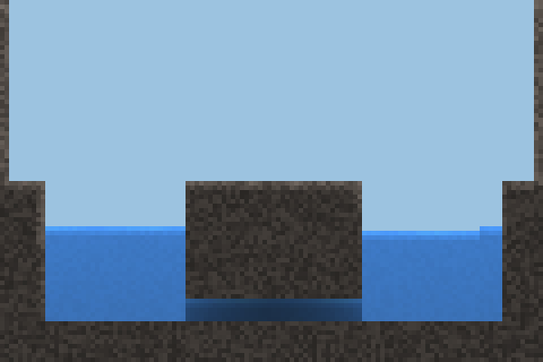
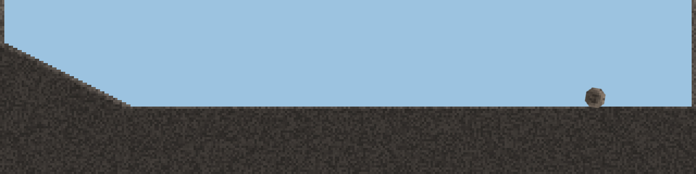
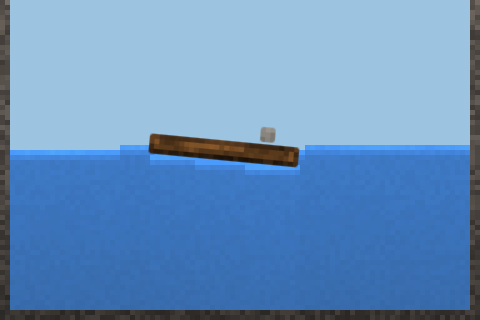
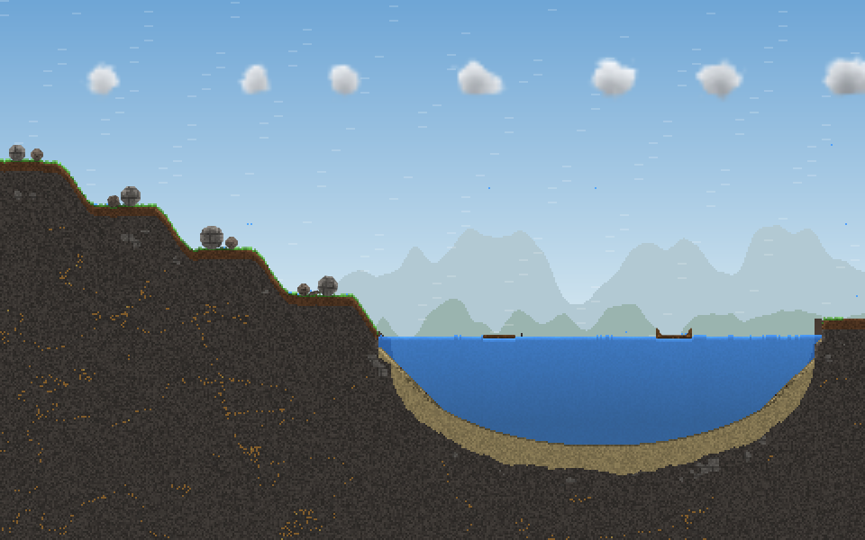
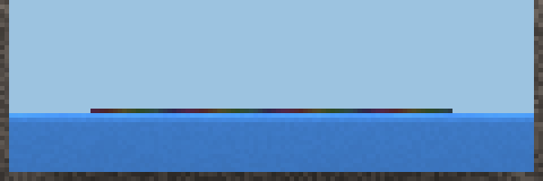
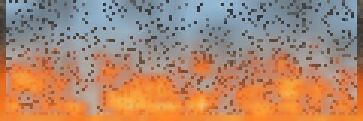
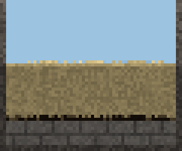
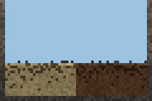

# Phase 4b: Bericht

Phase 4b: Optik und Bewegungsgefühl (Punkte 1 bis 9), danach das neue Material Erdöl (Punkt 10). Phase 5 (Bewohner) ist nicht begonnen.

**Build:** [`beta-108`](https://github.com/shootcat/ReAct/releases/tag/beta-108), APK, Screenshots und Messwerte des CI-Rechners dort.
- **Zwischenbuild nach Punkt 9:** [`beta-107`](https://github.com/shootcat/ReAct/releases/tag/beta-107), grün.
- Der Zwischenbuild davor, `beta-106`, war **rot**: 10 von 16 App-Tests liefen in die Wartezeit („Compose did not get idle“).
  - Ursache: Die Schleife, die die Körperbilder zwischen zwei Simulationsbildern weiterzeichnet (Punkt 6), bat ohne Pause um das nächste Bild.
  - Behoben in `4ee7048`: Sie läuft nur noch nach einem neuen Bild und nur, solange ein Körper sichtbar unterwegs ist.

## Überblick

| Punkt | Stand |
|---|---|
| 1 Wolken | umgesetzt: Höhenschicht, keine Stapel und Kegel, Ausbreiten, Drift, Ballen; weiche eigene Bildebene |
| 2 Licht und Schatten | umgesetzt: keine dunklen Säulen mehr, Licht im Bild diffus, Schatten nur auf Oberflächen |
| 3 Wasser waagerecht | umgesetzt: Pegelausgleich, verbundene Gefäße bis auf eine Zelle |
| 4 Umfallen | umgesetzt: Schwerpunktregel, kein Balancieren, Kippen beschleunigt, Stämme rollen aus |
| 5 Keine Verschmelzung | umgesetzt: Stückkennung je Zelle, verbunden ist nur, was in einem Zug gebaut wurde |
| 6 Gedrehte Körper | umgesetzt: eigene geglättete Bilder, zwischen den Schritten weitergezeichnet |
| 7 Schwimmen | umgesetzt: Schaukeln mit Dämpfung, Eintauchen nach Dichte, Welle, keine Lücken, Floß mit Last neigt sich |
| 8 Holz | umgesetzt: Maserung in Pinselrichtung, Rinde, weniger Treppe |
| 9 Leistung und Vorlage | Wärme optimiert (gleiche Zahlen, Level unverändert); Vorlage „See, Hang und Wolken“ |
| 10 Erdöl | umgesetzt mit allen Eigenschaften der Vorgabe, 15 Einträge im Entdeckungsbuch; **kein bestehender Level enthält bisher Öl** (Abschnitt 10) |

## 1. Wolken

**Simulation:**
- Wolken hängen in ihrer Schicht: von der Kondensationshöhe bis 14 Reihen darüber, nie näher als 3 Reihen an der Weltdecke.
  - Darunter steigen sie, darüber sinken sie zurück. Was außerhalb der Schicht ist, bleibt wach, bis es drin ist.
  - In der Schicht sinkt eine Wolke langsam auf die Basis, mit 0,05 je Schritt und nur, wenn keine Wolke unter ihr ist.
  - Eine Wolke, die von unten an eine Wolke stößt, setzt sich oben auf, wie kondensierender Dampf. So bleibt die Unterseite flach, und die Wolke wächst nach oben.
- Es gibt kein seitliches Abrutschen mehr, also keine 45°-Kegel. Seitlich breitet sich eine Wolke nur aus, wenn eine Säule mindestens 4 Zellen tiefer ist als die daneben. So entstehen runde, steile Flanken.
- Einzelne Fetzen mit höchstens 2 Wolkennachbarn ziehen zur nächsten Wolkenmasse (Fenster ±5 Spalten, ±2 Reihen).
- Der Wind schiebt die Wolken wie bisher. Am Berg steigt die Wolke nur bis zur Oberkante der Schicht, nicht mehr bis an die Weltdecke.
- **Gemalte Wolken** erscheinen als Ballen: voll in der Mitte, der Rand nach Rauschen ausgefranst.
- **Gemessen:**
  - Ein gemalter Ballen hat nach 20 s die Säulenhöhen 2, 4, 7, 8, 8, 9, 10, 11, 9, 7, 4, 1.
  - Ein schmaler Turm von 4 Spalten wird 15 Spalten breit.
  - 40 einzelne Fetzen sammeln sich zu einer Wolke (danach 0 Fetzen).

**Neue Regel: Steigungsregen.** Eine Wolke, die der Wind gegen Gelände drückt, regnet an der Luvseite (0,01 je Blick, alle 10 Schritte).
- Grund: Level 5 lebte davon, dass sich die Wolken an der Klippe auftürmten. Ohne das kam halb so viel Regen aufs Feld: 8 statt 14 Wasserzellen bei 240 s, nach 300 s 23 Pflanzen.
- Gemessen: Mit 0,02 hätte der Tuffweg schon bei 179 s Silber statt Bronze geholt. Mit 0,01 bleibt er Bronze.

**Gewitterbank:** Die Wolkentiefe wird über 9 Spalten gemittelt; Spalten ohne Wolke zählen nicht mit.
- So unterbrechen einzelne Lücken die Bank nicht.
- Grund: In Level 4 schlug der Blitz durch eine Lücke in der Bank neben den Pfosten in den nassen Stoß. Der Silberweg ging dadurch verloren und geht jetzt wieder (13,7 s).

**Darstellung:** Wolken haben eine eigene weiche Bildebene (2 × 2 Zellen je Pixel, geglättet skaliert).
- Die Dichte wird zweimal weichgezeichnet. Der Rand bekommt ein langsam wanderndes Rauschen.
- Farbe:
  - Oben ist die Wolke hell (#F6F8FB) und wird nach unten grauer, je mehr Wolke über einer Stelle liegt.
  - Eine gewöhnliche Wolke wird höchstens auf 74 % abgedunkelt.
  - Erst ab 9 Zellen Dicke wird sie zunehmend dunkel wie eine Gewitterwolke, bis 40 %.
- Die Wolkenzellen selbst werden als Himmel gezeichnet.

**Licht durch Wolken:** `light_pass` von Wolke 0,8 → 0,97 je Zelle. Wolken dimmen den Boden jetzt nur leicht.

## 2. Licht und Schatten

**Ursache der dunklen Säulen:** Der Hintergrund (Höhlenwand unter der Bodenlinie) nahm Wasser, Tropfen, lose Körper und Sand in der Luft als Boden. Unter jedem Tropfen, See oder Brocken stand dadurch eine Säule dunkler Fels. Sie war sichtbar, sobald sich etwas bewegte, und durch Wasser hindurch.
- Neu: Die Bodenlinie besteht nur aus aufliegendem, festem Gelände (kein Wasser, keine Körper, nichts Schwebendes), als Median über 7 Spalten.

**Schatten nur auf Oberflächen:** Unter freiem Himmel (über der Bodenlinie) werden Luft, klares Wasser und Rauch nicht abgedunkelt. Höhlen und Überhänge unter der Bodenlinie bleiben dunkel.

**Diffuses Licht im Bild:** Das Himmelslicht kommt aus 5 Richtungen: senkrecht mit 0,36, unter ±45° mit je 0,22, unter ±63° mit je 0,10. Danach wird es gestreut wie bisher. Kleine Dinge werfen weiche Schatten, die mit dem Abstand schwächer werden.

**Was ich nicht geändert habe:** Das Licht, nach dem Pflanzen und Tiere leben, bleibt senkrecht wie bisher. Ich habe diffuses Licht auch für die Simulation ausprobiert:
- Enge Schächte und kleine Öffnungen wurden deutlich dunkler: unter einer 4-Zellen-Öffnung 0,44 statt mehr als 0,8, am Boden eines 22 Zellen tiefen Wasserschachts 0,26 statt mehr als 0,4.
- Die Tests für Gras, Glühwürmchen und Bäume schlugen fehl.
- Das Spielverhalten bleibt deshalb unverändert; nur das Bild ist diffus.

## 3. Wasser waagerecht

**Pegelausgleich** (`World.levelLiquids`, alle 8 Schritte, nur in Chunks mit Aktivität):
- Er gilt für ruhende dünne Flüssigkeit, also Wasser und Salzwasser (Zähigkeit < 0,3; nicht Lava, Metall oder Öl).
- Bei zusammenhängender Flüssigkeit wandern die höchsten Oberflächenzellen an die tiefste freie, gestützte Stelle daneben oder darüber. Das geht so lange, bis der Unterschied höchstens 1 Zelle beträgt.
- Fließt mehr als 1/20 der Flüssigkeit, passiert nichts.

**Gemessen:**
- Becken, 196 Zellen breit, von einer Stelle aus gefüllt: vorher Spiegel bei 39 bis 44 (Stufen), jetzt bei 38 bis 39.
- U-Rohr: vorher links 39 und rechts 61 (kein Ausgleich), jetzt 50 und 50 bis 51.

## 4. Umfallen

**Schwerpunktregel:** Bevor ein Körper einschläft, wird geprüft, ob sein Schwerpunkt über dem Fuß liegt (0,1 Zelle Rand).
- Kein Balancieren: Ein Fuß von höchstens 2 Zellen unter einem mehr als 4-mal so breiten Körper trägt nicht.
- Sonst bekommt der Körper einen Anstoß von 0,002 rad je Schritt zur Gewichtsseite.
- **Gemessen:**
  - Eine Raute auf der Spitze kippte vorher nie (0°, schlafend). Jetzt kippt sie (−2°, −11°, −45°) und liegt auf der Seite.
  - Ein angestoßener Pfosten (2 × 32) zeigt alle 4 Schritte 1°, 2°, 4°, 6°, 9°, 14°, 20°, 29°, 42°, 61°, 75°, 84°, 89°, 90°: langsamer Beginn, schneller Fall.

**Runde Körper rollen.** Als rund gilt ein Körper mit mindestens 9 Zellen, bei dem das Verhältnis der Randzellen nah zu fern über 0,85 liegt.
- Er hat einen Kontaktpunkt unter dem Schwerpunkt. Das Raster dreht nicht mit, nur das Bild.
- Stamm mit Radius 5: vorher holperte er mit 0,1 bis 0,3 Zellen je Schritt und blieb nach 62 Zellen stehen. Jetzt rollt er mit 1,3 bis 1,7 Zellen je Schritt den Hang hinab und rollt auf der Ebene aus.
- Radius 3: vorher Halt bei x 89 (wackelte 450 Schritte), jetzt rollt er bis x 193 und läuft langsam aus.

**Eingespannt:** Hat eine Zelle festen Halt links und rechts oder oben und unten, dreht sich der Körper nicht.
- Grund: Ein Pfosten von 1 Zelle Breite in einer 1 Zelle breiten Fuge kann sich im Raster um bis zu 8° drehen, ehe die Fuge greift.
- Ohne das Verschmelzen (Punkt 5) kippte er heraus (Level 4, kurzer Pfosten).

**Stäbe:**
- Am 45°-Hang bleibt ein Stab am Hangfuß schräg zwischen Hang und Boden liegen; das ist eine mögliche Ruhelage.
- Am 1:2-Hang bleibt er liegen (Reibung 0,6 > tan 26,6° = 0,5).

## 5. Keine Verschmelzung

- Jede Zelle trägt eine Stückkennung (`World.piece`).
  - Ein Druck (nicht mit der Hand) beginnt ein Stück, das Loslassen beendet es. Linie und Rechteck sind je ein Stück. Was die Hand ablegt, ist ein neues Stück.
  - In der Vorlage „Wald am Hang“ ist jeder Brocken, jeder Stamm und das Floß ein eigenes Stück.
- Strukturen verbinden nur Zellen desselben Stücks. Das Verschmelzen ruhender Körper ist entfernt.
- Stück 0 bedeutet „von der Welt gemacht“ (Level-PNG, Tests). Es verbindet sich wie bisher mit jeder Zelle von Stück 0. Eine Struktur wird also nur Welt, wenn sie am Fels verankert ist.
- Der Schnappschuss braucht 2 Byte mehr je Zelle (11 statt 9). Die nächste Stücknummer und die Stückkennung gehen in den Hash ein, Undo und Determinismus bleiben gültig.

## 6. Gedrehte Körper als Bilder

- `Renderer.renderBodies` zeichnet jeden Körper als eigenes Bild in seinem Rahmen, mit 4 × 4 Pixel je Zelle.
  - Die Farben kommen aus dem Rasterbild, also mit Licht, Glut und Hervorhebung der Hand.
  - Der Rand ist geglättet: Die Deckung wird bilinear aus der Belegung berechnet, die Kante ist über 0,3 Zelle weich, und Ecken zwischen schräg benachbarten Zellen werden zur Schräge.
  - Gedreht wird um den Schwerpunkt; runde Körper drehen im Bild mit.
- Im Raster werden Körperzellen mit ihrer Umgebung gefüllt (bis 3 Zellen weit gesucht, sonst Hintergrund). Das Raster bleibt für Kollision und Simulation zuständig.
- **Zwischenpositionen:** Jedes Bild trägt die Lage jetzt und die Lage im Bild davor. Die App zeichnet dazwischen nach der verstrichenen Zeit (Abstand der Bilder höchstens 0,1 s).
  - Gezeichnet wird das nur, solange ein Körper sichtbar unterwegs ist: mehr als 0,05 Zellen oder 0,01 rad.
  - Grund dafür ist der rote `beta-106`.
- Ein unveränderter Körper behält sein Bild (Prüfsumme der Zellfarben). Die App hat je Körper eine Bitmap und befüllt sie nur bei geänderten Pixeln neu.
- Die Testbilder zeichnen die Körper ebenso.

## 7. Schwimmen

**Wasserlinie:** Für den Auftrieb ist die Wasserlinie stetig: das Mittel über 6 Spalten je Seite, ab 2 Zellen neben dem Körper.
- Ein Floß ohne Last sprang vorher endlos zwischen zwei Zeilen.
- Jetzt schaukelt es gedämpft: 27,2 → 30,8 → 27,5 → 29,7 → 29,0 in etwa 1 s.

**Holz:** Dichte 650 → 500, es taucht also etwa zur Hälfte ein.

**Verdrängen:** Verdrängte Flüssigkeit geht an die nächste freie, gestützte Stelle neben dem Körper.
- Beim schnellen Eintauchen (mehr als 1,2 Zellen je Schritt) landet sie 2 Reihen höher, als Welle.
- Frei gewordene Zellen unter Wasser füllen sich wieder. Lücken unter Wasser neben dem Körper: 0.
- Vorher landete das verdrängte Wasser auf dem Floß.

**Mitfahren:** Ein Körper, der ruhig auf einem einzigen bewegten Körper liegt (6 Schritte, weniger als 0,15 Zellen je Schritt relativ), fährt mit.
- Er bleibt ein eigener Körper; sein Gewicht drückt den Träger hinunter und neigt ihn.
- Er steigt ab, wenn der Träger steiler wird, als die Reibung hält, oder wenn er getroffen wird.
- Träger und Mitfahrer werden in einem Zug versetzt.
- **Gemessen:** Eine Last wurde aus 1 bis 6 Zellen Höhe an drei Stellen abgeworfen. In 10 von 12 Fällen bleibt sie liegen; die beiden Abgänge geschahen 3 Zellen vor dem Ende. Neigung 5,4°, ruhig.

**Ganz Untergetauchtes:** Ist ein Körper leichter als die Flüssigkeit und ganz darin, ruht er nicht, sondern steigt weiter. Das betrifft Glas (2500) in Lava (2600).

## 8. Holz

**Maserung in Pinselrichtung:**
- Gespeichert wird die Richtung des Zuges; bei einer Linie ihre Richtung, beim Rechteck die lange Seite.
- Sie liegt beim Malen in 2 Bits der Zellvariante: waagerecht, fallend, senkrecht oder steigend.
- Alle 4 Zellen liegt eine leicht wellige Linie quer zur Faser. Bei Körpern wandert die Maserung im eigenen Rahmen mit.

**Rinde:** Randzellen haben 74 % Helligkeit und 30 % Dunkelbraun (#4A3020) beigemischt. Gemessen: innen 248, Rand 170 (Summe RGB).

**Weniger Treppe:** Die Kerbe einer Stufe nimmt 50 % Holz an, die äußere Stufenecke 40 % der Umgebung.
- Das gilt für feststehendes Holz.
- Körper sind über ihr geglättetes Bild ohnehin glatt.

## 9. Leistung und Vorlage

### Vorlage „See, Hang und Wolken“

- Links ein Terrassenhang mit runden Felsbrocken und Stämmen (Totholz) und einem langen Stamm.
- Rechts ein See mit einem Floß (18 × 2) und einem Bootsrumpf (20 Zellen Holz).
- Darüber 7 Wolkenballen in einer Brise: Wind 0,3, Böen 0,15.
- Test:
  - Nach 900 Schritten schwimmen Floß und Boot.
  - Mindestens 8 Körper liegen noch am Hang.
  - Die Wolken sind mehr als 5 Zellen windab gewandert.

### Leistung

**Grenze:** höchstens 8 ms je Schritt auf dem Gerät, Zeile „voll aktiv belebt, dazu 150 Körper“ in „Leistung messen“.

**Vor der Optimierung** (dieser Rechner, je 2 Läufe abwechselnd, derselbe Benchmark):

| Zeile | Phase 4 | Phase 4b vor der Optimierung |
|---|---|---|
| voll aktiv belebt, dazu 150 Körper | 14,55 / 13,99 ms | 15,68 / 14,41 ms |
| davon Körper | 1,87 / 1,80 ms | 2,83 / 2,59 ms |

Die Körper kosten mehr, weil es mehr davon gibt: im Mittel 4665 statt 3103 Körper, 1578 statt 777 in Bewegung. Stücke verschmelzen nicht mehr, und Körper balancieren nicht. Hochgerechnet aufs Fold2 lag das über 8 ms. Also zuerst die Wärme, wie im 3c-Bericht vorgeschlagen.

**Wärme ohne schwer vorhersagbare Verzweigungen:**
- Profil (Stichproben, 150-Körper-Welt): Wärme 26 %, Pulver 18 %, Körper zusammen etwa 20 % des Schritts. In der Messwelt unterscheiden sich 83 % der Nachbarpaare in der Temperatur, auf der Wiese nur 25 %.
- Varianten, gemessen auf einem festen Weltzustand (nur Wärme, 600 × 340, alle Chunks; Median):

  | Variante | belebt + Körper | Wiese | Zahlen |
  |---|---|---|---|
  | bisher | 3,8 ms | 2,1 ms | – |
  | Kleinstunterschied nicht mehr abfragen | 2,85 ms | 3,3 ms | letzte Stelle anders |
  | Fragen umsortiert, eine Tabelle | 3,55 ms | 2,0 ms | gleich |
  | **unruhige Chunks ohne Abfrage per Bitmaske, ruhige wie bisher** | **2,95 ms** | **1,70 ms** | **gleich** |

- **Gewählt** ist die letzte Variante.
  - Unruhig heißt: In einem Chunk waren beim letzten Schritt mehr als die Hälfte der Nachbarpaare verschieden warm. Dort wird jedes Paar gerechnet; ein Unterschied bis 0,001 Grad wird per Bitmaske zu null.
  - Ruhige Chunks überspringen solche Paare wie bisher.
  - Die Temperaturen sind Bit für Bit dieselben (Prüfsumme gleich). Deshalb sind alle Level unverändert, und keine Messung musste wiederholt werden.
- Verworfen, weil ohne messbaren Gewinn: Abkühlen der Luft ohne Verzweigung, eine eigene Kopie der Schleife je Chunkart, Fragen nach Luft mit einem einzigen Vergleich.
- Dazu: Die Lückensuche gedrehter Körper fragt den Umriss nur noch für Zellen, die noch gewinnen können. Das Ergebnis ist gleich, die Körper werden etwa 5 % schneller.
- Im Ablauf ganzer Schritte sinkt die Wärme von 4,0 bis 4,2 auf 2,6 bis 2,8 ms.
  - Im Benchmark selbst, nach allen anderen Welten, sind es 3,4 bis 3,8 ms. Das ist ein Effekt des Desktop-JIT: Dieselbe Welt allein kostet 2,8 bis 2,9 ms, nach den anderen 3,44 ms.

**Nachher, im selben Zeitraum abwechselnd gemessen:**

| Rechner | Phase 4 | Phase 4b |
|---|---|---|
| dieser Rechner | 12,55 / 12,19 ms | 12,49 / 11,64 ms (und 11,25 / 12,24) |
| CI-Rechner (je ein Lauf) | 19,81 ms (`beta-103`) | 18,11 ms (`beta-107`) |

Weitere Zeilen auf dem CI-Rechner, `beta-107` gegen `beta-103`:

| Welt (600 × 340) | Phase 4 (`beta-103`) | Phase 4b (`beta-107`) |
|---|---|---|
| voll aktiv | 16,57 ms | 13,61 ms |
| voll aktiv, belebt | 19,99 ms | 15,73 ms |

**Hochgerechnet auf das Galaxy Z Fold2: 6,7 bis 7,9 ms**, unter der Grenze von 8 ms.
- Nach dem Verhältnis auf dem CI-Rechner (18,11 / 19,81 × 7,3 ms): **6,7 ms**.
- Nach dem Verhältnis auf diesem Rechner (etwa 0,96 × 8,2 ms): **7,9 ms**.
- **Den gültigen Wert liefert „Leistung messen“ auf dem Gerät.** Die Zeile zeigt jetzt auch die Zeit der Wärme.
- Liegt der Wert über 8 ms, ist der nächste Hebel das Pulver (18 % des Schritts). Dort ändert aber jeder Umbau die Reihenfolge der Zufallszahlen und damit die Level.

**Bild:** Neu im Benchmark ist das ganze Bild, wie die App es macht: Bild, Wolkenebene, Körperbilder, Dunst, Licht, Flammen, in der Vorlage „See, Hang und Wolken“ (480 × 300).
- Dieser Rechner: 3,9 bis 4,9 ms.
- CI-Rechner: 5,15 ms.
- Das Bild allein (Spielplatz 200 × 350) kostet 1,3 bis 2,8 ms, auf dem CI-Rechner 2,62 ms.

## 10. Erdöl

Alles folgt aus Eigenschaften in `materials.json`, keine Rezepte. Neue Stoffe:

| Stoff | Rolle |
|---|---|
| Erdöl (`oil`) | Flüssigkeit, Dichte 870 |
| Ölquelle (`oil_spring`) | Gelände wie Fels, gibt Öl ab |
| Teer (`tar`) | sehr zäh, klebt, brennt gut |
| Ruß (`soot`) | leichtes Pulver, vom Wind getragen |
| Qualm (`black_smoke`) | schwarzer Rauch, lässt beim Vergehen etwas Ruß fallen |
| Ölgas (`oil_gas`) | explosiv wie Grubengas |
| Ölsand, ölige Erde | Sand und Erde mit Öl darin, brennbar |

Neue Felder:

| Feld | Bedeutung |
|---|---|
| `thin_temp` | warm dünner |
| `douse_proof` | Wasser löscht nicht |
| `smoke_product` | Art des Rauchs |
| `carries_powder` | Pulver sinkt nicht ein |
| `stains` / `stained_product` | sickert ein |
| `poisons` / `dies_in_oil` | vergiftet |
| `evaporates` / `evaporate_product` / `evaporate_share` | verdunstet zu Teer |
| `outgas` / `outgas_temp` | gast aus |
| `sticky` | klebt |
| `decay_share` | Qualm lässt teils Ruß |
| `catch_time` | fängt Feuer durch Berührung |

Ohne Öl verhält sich die Welt Zelle für Zelle wie vorher. Alle 25 Levellösungen ergeben dieselben Zeiten und Medaillen.

**Die Vorgabe Punkt für Punkt, gemessen** (Tests in `OilTest`, 13 Fälle):
- **Zähflüssig, warm dünner:** Breite nach 1 s auf ebenem Boden: Wasser 116 Zellen, kaltes Öl 37 bis 41, Öl bei 140 °C 69 bis 73. Kaltes Öl breitet sich weiter aus, nach 4 s 71 bis 75.
  - Zähigkeit 0,85, frei ab 160 °C.
  - Ein zähes Öl, das noch fließen könnte, hält seinen Chunk wach. Vorher schlief eine dicke Lache einfach ein.
- **Leichter als Wasser, mischt sich nicht, Film:** Ein Klumpen auf dem See liegt nach 10 s als Film von 1 Zelle Dicke über 80 Spalten; im Wasser ist kein Öl.
- **Hohe Zündtemperatur, Funke reicht nicht:**
  - Zündtemperatur 380 °C, dazu Fangen durch Berührung: Was 0,6 s lang an etwas Brennendem liegt (auch schräg), fängt Feuer.
  - Eine einzelne Flamme lebt höchstens 31 Schritte, also etwa 0,5 s.
  - Gemessen:

    | Auslöser | Öl brennt |
    |---|---|
    | Funke | nie |
    | Funke in einem Kasten direkt über dem Öl | nie |
    | Glut | nach 35 Schritten |
    | gehaltene Flamme | nach 8 Schritten |
    | glühendes Brett | nach 24 Schritten |
    | Lava daneben | nach 5 Schritten |
- **Brennt sehr heiß und lange, viel schwarzer Rauch und Ruß:** bis 1150 °C, 15 s je Zelle (Holz 4,5 s). Eine Lache brennt Schicht für Schicht ab: 160 → 61 Zellen in 90 s.
  - Qualm 0,05 je Schritt, das Fünffache von Holz.
  - Ruß bleibt als Rest (30 %) und fällt aus dem Qualm.
- **Brennendes Öl auf Wasser:** Das Feuer läuft in 15 s über einen Film von 100 Zellen.
  - Das brennende Öl zieht Luft aus den 8 Nachbarn, also auch an seinem Qualm vorbei.
- **Wasser löscht nicht, verteilt und spritzt:**
  - Wasser kühlt brennendes Öl nicht unter den Brennpunkt.
  - Wasser, das hineinfällt, schleudert das brennende Öl 3 bis 6 Zellen hoch und bis 3 seitwärts.
  - Gemessen: Die Lache brennt weiter und wird von 40 auf 76 Spalten verteilt; Öl fliegt bis Zeile 3.
- **Ersticken mit Sand, Erde, Abdecken:** Sand und Erde sinken nicht in Öl ein, sie decken es ab. Ohne Luft unter der Decke ist das Feuer in 10 s aus; unbedeckte Ränder brennen weiter.
- **Sickert in Sand und Erde, macht sie brennbar:** etwa 0,08 je Zufallstick und Nachbar, also langsam. Nach 5 s ist noch mehr als die Hälfte da, nach 60 s weniger als ein Viertel.
  - Ölsand gibt das Öl nach unten an sauberen Sand weiter, bis 9 Zellen tief.
  - Ölsand und ölige Erde brennen, wo Luft hinkommt; sauberer Sand nicht.
- **Pflanzen und Fische sterben:**
  - Gras unter einer Öllache ist nach 20 s tot, Gras daneben lebt.
  - Fische sterben bei Berührung sofort und unter einem Ölfilm nach 15 s. Im Teich ohne Film leben alle 4.
  - Dabei gefunden: Ein toter Fisch, der unter dem Film treibt, verdeckte ihn für die Prüfung. Die Prüfung schaut jetzt durch Treibgut hindurch.
- **Ausgasen im geschlossenen Raum:** Ab 120 °C geht Ölgas in eingeschlossene Luft daneben. Gemessen: 240 Gaszellen in 20 s; ein Funke im Raum löst die Explosion aus. Im offenen Raum entsteht kein Gas.
- **Teer:**
  - Öl an der offenen Oberfläche verdunstet langsam, warm deutlich schneller (bei 250 °C 80 → 60 Zellen in 60 s). 40 % bleiben als Teer.
  - Teer klebt an Fels, Wänden und Körnern (unter einem Überhang hängt die Lage, die den Fels berührt); Körner auf Teer rutschen nicht.
  - Teer brennt gut und fängt von Glut Feuer.
- **Beschaffung:**
  - Die Ölquelle im Gestein lässt Öl austreten. Eine Tasche unter Fels bleibt voll, bis man sie öffnet.
  - Levelkarten setzen beides über ihre Farbe.
  - Der Eimer nimmt Öl, aber kein brennendes; die Regel gab es schon für alles Brennende.
- **Darstellung:**
  - Schwarzbraun, an der offenen Oberfläche ein wandernder Glanz, in der Tiefe leichte Schlieren.
  - Ein Film auf Wasser schimmert schwach in Regenbogenfarben.
  - Teer ist schwarz mit demselben Glanz.

Auf dem Weg geänderte Werte, alle gemessen:

| Wert | erster Wert | jetzt | Grund |
|---|---|---|---|
| Leitfähigkeit | 0,1 | 0,05 | Glut kühlte aus, bevor das Öl fing |
| Qualm je Schritt | 0,3 | 0,05 | Die Lache erstickte am eigenen Qualm immer wieder und brannte nie ab |
| Wärme je Schritt | 70 | 45 | Ein brennender Film kochte das Wasser darunter zu Dampf |
| Brenndauer | 25 s | 15 s | Ruß soll in der 20-s-Szene des Entdeckungsbuchs erscheinen |
| Seitliche Reichweite | 12 | 40 | Der Film blieb stellenweise 2 Zellen dick |
| Einsickern | 0,15 | 0,08 | Zu schnell für „langsam“ |

**Vorlage Höhlensystem:** Rechts unten liegt eine Öltasche unter Fels (411, 794 bzw. 1118 Zellen in den drei Größen), in der Wand der Kieskammer eine Ölquelle.

**Spielplatzleiste:** Erdöl und Teer unter „Flüssig“, Ruß unter „Lose“.

**Was fehlt:** Keiner der fünf Level enthält bisher Öl. Ich habe keinen bestehenden Level verändert, weil das neue Wege öffnen und die Medaillen verschieben würde. Ein eigener Öl-Level (Vorschlag in `docs/ELEMENTE.md`) ist der nächste Schritt.

**Leistung mit Öl:**
- In Welten ohne Öl kein messbarer Unterschied (abwechselnd gemessen; der Rechner war in dieser Stunde langsamer):

  | Zeile | vor Erdöl | nach Erdöl |
  |---|---|---|
  | voll aktiv belebt, dazu 150 Körper | 19,09 / 17,84 ms | 17,91 / 18,03 ms |

- Ein brennender Ölfilm über dem ganzen See der größten Vorlage (273 Zellen Öl, etwa 2100 Zellen Qualm, 108 von 209 Chunks wach) kostet 5,7 bis 6,4 ms je Schritt, ohne Öl 1,3 bis 1,7 ms. Das liegt deutlich unter der Messwelt.

## Level 1 bis 5

Alle Lösungswege aller fünf Level funktionieren, mit denselben Medaillen wie in Phase 4. **Kein Level und keine Medaillengrenze ist geändert.** Gemessen mit den Lösungstests (Zeit · Griffe):

| Level, Weg | Phase 4 | Phase 4b | Medaille |
|---|---|---|---|
| L1 Feuer | 15,2 s · 2 | 14,3 s · 2 | Gold |
| L1 Graben | 40,2 s · 1 | 38,2 s · 1 | Gold |
| L1 Anspülen | 51,7 s · 6 | 56,7 s · 6 | Silber |
| L1 Rinne | 96,8 s · 2 | 95,5 s · 2 | Silber |
| L1 Tragen | 13,0 s · 30 | 13,0 s · 30 | Bronze |
| L2 Schmelzen | 14,3 s · 8 | 14,3 s · 8 | Gold |
| L2 Ins Meer | 9,8 s · 12 | 9,2 s · 12 | Silber |
| L2 Salzwasser | 13,3 s · 10 | 13,3 s · 10 | Silber |
| L3 Scherben | 15,8 s · 10 | 15,8 s · 10 | Gold |
| L3 Lava | 14,2 s · 12 | 14,3 s · 12 | Silber |
| L3 Wasser auf Lava | 17,0 s · 14 | 17,0 s · 14 | Silber |
| L3 Erz | 113,8 s · 14 | 169,8 s · 14 | Silber |
| L4 langer Pfosten | 5,2 s · 2 | 8,8 s · 2 | Gold |
| L4 kurzer Pfosten | 7,0 s · 2 | 6,3 s · 2 | Gold |
| L4 geerdet, dann höher | 13,7 s · 4 | 13,7 s · 4 | Silber |
| L4 Pfosten nach 90 s | 92,8 s · 2 | 93,8 s · 2 | Bronze |
| L4 später Pfosten | 137,3 s · 2 (nach 130 s) | **123,7 s · 2 (nach 120 s)** | Bronze |
| L5 drei Eimer | 34,7 s · 6 | 52,2 s · 6 | Gold |
| L5 sechs Eimer | 37,8 s · 12 | 33,3 s · 12 | Silber |
| L5 heißer Tuff | 240,5 s · 6 | 183,8 s · 6 | Bronze |

**Was dafür nötig war (gemessen, alle in der Simulation, nicht im Level):**
- **L3 Scherben** ging zwischendurch nicht (0 Scherben in der Kammer). Drei Ursachen:
  1. Glas (2500) in Lava (2600) schwebt fast. Ganz untergetaucht stieg es mit 0,05 Zellen je Schritt und schlief unter der Oberfläche ein. Jetzt ruht ein leichterer, ganz untergetauchter Körper nicht.
  2. Die ferne Wasserlinie gilt nur für dünne Flüssigkeiten. Bei zäher Lava zählt die Lava direkt neben dem Körper.
  3. Liegt Flüssigkeit über der obersten Reihe, ist der Körper ganz untergetaucht. Vorher hielt ein Stück von 1 Zelle seine eigene Oberkante für den Spiegel.

  Ergebnis: Gold, 9 Scherben in der Kammer.
- **L2 Salzwasser** ging zwischendurch nicht: Das Salzwasser auf der Schneehaube hob den Holzstoß an.
  - Die Ursachen:
    - Wasser oben auf dem Schnee galt als Spiegel.
    - Wasser in den Lücken zwischen den Scheiten galt als See über dem Stoß. Er stieg wie eine Rakete bis an den Weltrand.
    - Fallende Tropfen zählten mit.
  - Jetzt trägt Flüssigkeit neben einer Reihe nur, wenn sie ununterbrochen bis zur Unterkante reicht; Hohlräume im Körper tragen nicht.
  - Ergebnis: Der Stoß bleibt liegen wie vor 4b.
- **Phase-4-Fehler behoben:** Ein gedrehter Körper fand beim Rastern für eine verdrängte Zelle im Umkreis 2 keinen Platz und konnte sich nicht mehr bewegen. Ein Holz-Stein-Verbund blieb so kopfüber mitten im Wasser stehen. Der Umkreis ist jetzt 4.
- **L4:** Die Gewitterbank wird gemittelt (Punkt 1). Ohne Hilfe treffen alle Blitze Grat und Hügel, nie den Stoß.
- **L5:** Der Steigungsregen (Punkt 1) gleicht aus, dass sich die Wolken nicht mehr an der Klippe auftürmen.

**Warum sich Zeiten verschieben:** Die Wolkenregeln und der Pegelausgleich ändern den Ablauf des Wetters und des Wassers. In Level 5 kommt der Regen anders, in Level 4 fallen die Blitze anders. Die Medaillen bleiben in allen Wegen gleich.

## Geänderte Tests und Schwellen

Alle Änderungen, mit Grund. Keine Medaillengrenze, kein Level ist geändert.

| Test | vorher | jetzt | Grund |
|---|---|---|---|
| Level 4, später Pfosten | nach 130 s | **nach 120 s** | Ob ein spät gestellter Pfosten noch zündet, hängt an der Blitzfolge. Gemessen: Er zündet nach 95, 100, 105, 115, 120, 125 und 130 s, nicht nach 110 s. Er bleibt Bronze. |
| Level 2, Fallentest „Schnee erstickt den Krater“ | mehr als 150 Zellen Basalt | mehr als 80 Zellen Basalt und keine Lava offen an der Luft | Lose Krustenstücke wachsen nicht mehr zusammen (Punkt 5), sinken (Basalt ist schwerer als Lava) und schmelzen wieder. Gemessen: 98 Zellen, 0 offen. Die Falle hält. |
| Level 4, Pfosten auf dem Sandhaufen | – | umbenannt in „wird vom Regen weggespült …“ | Regen spült den Sand nach etwa 3 s unter dem Pfosten weg, er fällt ins Pfostenloch. Es brennt nichts, die Falle hält. |
| StructureTest „fällt als Ganzes“ | – | das T steht auf dem Kopf | Ein T auf 2 Zellen Stiel unter 10 Zellen Kopf kippt jetzt (Regel aus Punkt 4). |
| BodyTest, Eisdecke | – | Ufer mit 0 °C | Bei 20 °C schmolzen die Enden, und die Decke löste sich. |
| MaterialBehaviorTest Erz | Abtastung jede Sekunde | Abtastung alle 0,1 s, Schwelle gleich | Bei 0,6 s sind 11 Zellen flüssig, nach 1 s ist das Metall schon erstarrt. |
| WaterFeelTest, Floß mit Last | Last aus 5 Zellen fallen gelassen | Last 1 Zelle über dem Deck abgelegt | Messung zu Abwürfen in Abschnitt 7. |
| WeatherTest, erster Blitz | 40 s Wartezeit | 60 s | Der erste Blitz kommt zufällig: mit Startwert 7 nach 48,7 s, mit 8, 9 und 10 nach 0,4, 3,5 und 3,0 s. |

## Entdeckungsbuch

15 neue Einträge (jetzt 89), alle zu Erdöl und Teer, jeder mit eigener Szene. Alle Szenen zeigen ihre Eigenschaft innerhalb von 20 s:
- Erdöl …
  - „schwimmt auf Wasser, mischt sich nicht und breitet sich zu einem dünnen Film aus“
  - „fängt erst bei großer Hitze Feuer: ein Funke reicht nicht, eine Flamme oder Glut schon“
  - „brennt sehr heiß und lange, mit schwarzem Qualm, und hinterlässt Ruß“
  - „brennt auch auf dem Wasser; das Feuer läuft über die ganze Ölfläche“
  - „wird brennend von Wasser nicht gelöscht: das Wasser verteilt das brennende Öl und spritzt es auf“
  - „erstickt brennend unter Sand oder Erde, wenn keine Luft mehr herankommt“
  - „sickert langsam in Sand und Erde ein und macht sie brennbar“
  - „gast erhitzt in einem geschlossenen Raum aus; das Gas ist entzündlich“
  - „verdunstet langsam, in der Wärme schneller, und lässt zähen Teer zurück“
  - „fließt warm viel leichter“
- Ölgas „entzündet sich an Feuer explosionsartig, wie Grubengas“
- Gras (auch Moos, Ranke, Samen, Stamm, Laub) „stirbt in Erde, in die Öl gesickert ist“
- Fisch „stirbt in Wasser unter einem Ölfilm“
- Teer „klebt an Fels, Wänden und Körnern“
- Teer „brennt gut“

Neue Beobachtungen: `burn_on_water`, `splash`, `stain`, `die_oil`, `outgas`, `evaporate`, `stick` und `thin`. Dazu zählt `float` jetzt auch für eine leichte Flüssigkeit auf einer schweren.

## Tests

- Neu:
  - `OilTest` (13 Fälle, Abschnitt 10).
  - `SkyFeelTest`: Schicht, Decke, flache Unterseite, Ausbreiten, Fetzen, Drift, weiche Darstellung, Gewitterwolke, keine dunkle Säule, Schatten mit Abstand schwächer.
  - `LookTest`: Körperbilder, Zwischenlagen, Maserung, Rinde, Kerbe.
  - `WaterFeelTest` und `BodyFeelTest`.
  - Vorlage „See, Hang und Wolken“ in `TemplatesTest`.
- Benchmark: Wärmezeit je Welt und das ganze Bild der See-Vorlage sind neu.
- Insgesamt 273 Tests in Simulation und Leveln, alle grün; dazu die App-Tests in der CI.

## Grenzen und Offenes

- **Leistung:** Die Hochrechnung (6,7 bis 7,9 ms) ist keine Messung auf dem Gerät. Den gültigen Wert liefert „Leistung messen“, Zeile „voll aktiv belebt, dazu 150 Körper“.
- **Öl in Leveln:** Es gibt noch keinen Level mit Öl (Abschnitt 10).
- **Teer** klebt an Festem, nicht an Teer: Unter einem Überhang hängt nur die Lage, die den Fels berührt; was darunter hängt, tropft ab.
- **Diffuses Licht** gilt nur fürs Bild. Pflanzen und Tiere leben nach dem senkrechten Licht (Abschnitt 2).
- **Fische unter Ölfilm:** Ein Fisch, der kurz unter eine Lücke im Film schwimmt, fängt wieder bei null an zu zählen.

## Bilder

